[](https://www.python.org/)
[](https://fastapi.tiangolo.com/)
[](LICENSE)
[](https://github.com/dochavez/faultcase/actions)
[](https://www.meta.ai/)

[Read in English](README.md)

**Idea en una línea:** FaultCase convierte los fallos repetidos de un equipo con Windows 10 u 11 (portátil o de escritorio) en un caso de garantía listo para enviar al fabricante.

> **Funciona con cualquier marca.** FaultCase lee lo que Windows 10 y 11 ya registran, así que funciona en cualquier portátil o equipo de escritorio: Lenovo, HP, Dell, ASUS, Acer, MSI, Microsoft Surface, Samsung o un PC armado. El caso real de este proyecto son dos equipos Lenovo, pero nada del análisis depende de la marca; el fabricante solo cambia el enlace de soporte en la pantalla de Acción.

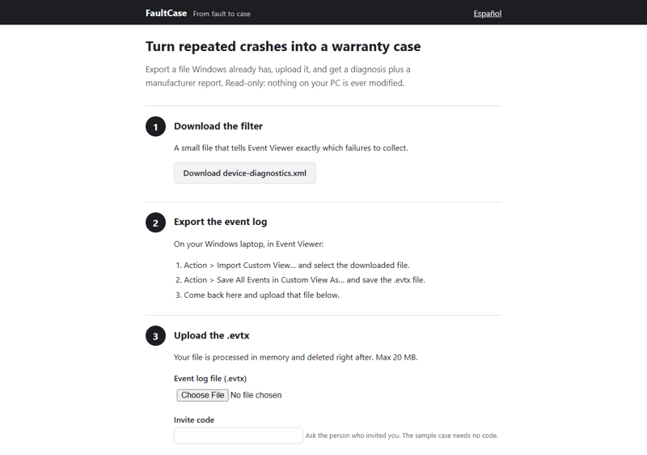

## Índice

- [Una noche frente a un minuto](#una-noche-frente-a-un-minuto)
- [Inspiración](#inspiración)
- [Por qué ayuda Muse](#por-qué-ayuda-muse)
- [Pruébalo en 1 minuto](#pruébalo-en-1-minuto)
- [Capturas de pantalla](#capturas-de-pantalla)
- [Cómo funciona](#cómo-funciona)
- [Modelos y proveedores](#modelos-y-proveedores)
- [Cómo trabajan juntos Muse, Baseten y Fireworks](#cómo-trabajan-juntos-muse-baseten-y-fireworks)
- [Cómo se construyó con Muse Code](#cómo-se-construyó-con-muse-code)
- [Privacidad y seguridad](#privacidad-y-seguridad)
- [Decisiones de diseño](#decisiones-de-diseño)
- [Limitaciones](#limitaciones)
- [Estructura del proyecto](#estructura-del-proyecto)
- [Ejecutar las pruebas](#ejecutar-las-pruebas)
- [Configuración](#configuración)
- [Hoja de ruta](#hoja-de-ruta)
- [Preguntas frecuentes](#preguntas-frecuentes)
- [Aviso](#aviso)
- [Licencia](#licencia)
- [Agradecimientos](#agradecimientos)

## Una noche frente a un minuto

Llegar a la conclusión del caso de demostración a mano tomó una noche entera. FaultCase hace el mismo trabajo desde una sola carga de archivos:

| Hecho a mano (una noche) | FaultCase (alrededor de un minuto) |
|---|---|
| Filtrar el Visor de eventos por eventos 41 / 6008 de Kernel-Power | `filters/device-diagnostics.xml` + `adapters/windows/evtx.py` |
| Ejecutar WinDbg `!analyze -v` en 4 volcados de memoria | `adapters/windows/windbg.py` (o `cdb.exe` local) |
| Comparar cubos de fallo y marcas de tiempo de controladores entre volcados | `rules.py`: `same_module`, `persists_across_driver_versions` |
| Contar incidentes, congelamientos y meses de historial | Bloque de resumen de `rules.py` (determinista, con pruebas) |
| Averiguar el modelo exacto de la laptop y la BIOS | Exportación de msinfo32 o lectura CIM local |
| Redactar el informe para el fabricante en dos idiomas | Redactor de casos con Muse Spark, EN + ES |

## Inspiración

Estas son las pantallas reales que dieron origen a FaultCase, fotografiadas con el celular porque eso es todo lo que suele tener un usuario cuando su equipo falla:

| Pantallazo azul: el código de error | Pantallazo azul: los parámetros | Un segundo equipo |
|---|---|---|
| 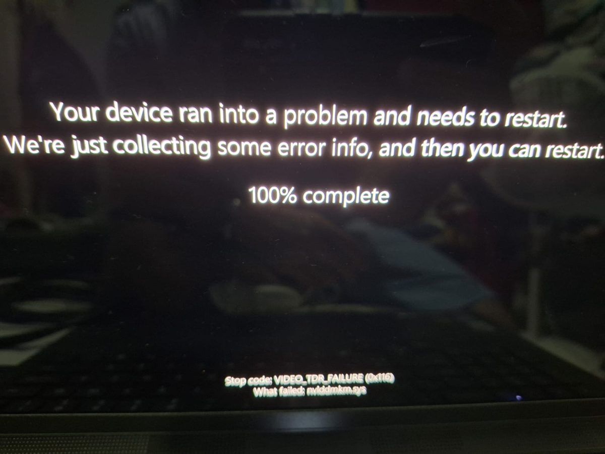 | 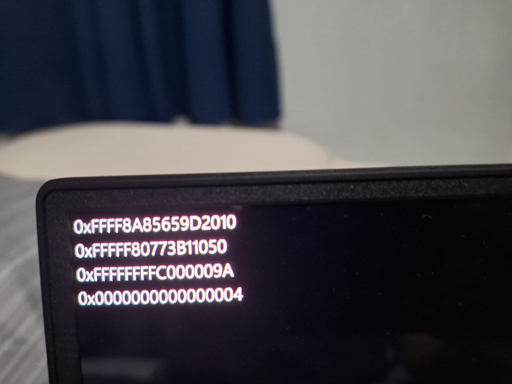 | 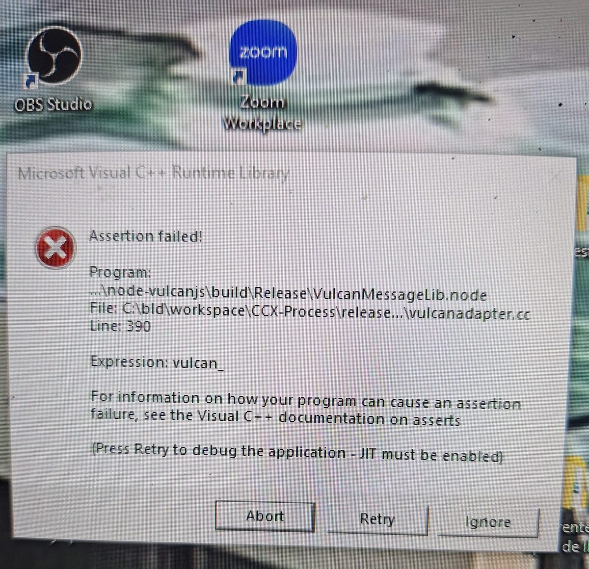 |
| `VIDEO_TDR_FAILURE (0x116)`, qué falló: `nvlddmkm.sys`, el controlador de pantalla de NVIDIA. | Los cuatro parámetros del bug check. El tercero, `0xFFFFFFFFC000009A`, es `STATUS_INSUFFICIENT_RESOURCES`. | El cierre de una aplicación ("Assertion failed") en un segundo equipo Lenovo que tengo. |

Cuando una laptop nueva se reinicia sola una y otra vez, el problema cae entre tres empresas: Microsoft es dueña del sistema operativo, NVIDIA del controlador y Lenovo de la garantía. Cada una solo ve su propia parte. El usuario termina con fotos borrosas de un pantallazo azul y un equipo de soporte que le pide datos que no sabe dónde encontrar.

Este proyecto nació de un caso real: una Lenovo Legion Pro 7 16IAX10H (tipo de máquina 83F5, GPU NVIDIA, comprada en enero de 2026) con 6 incidentes en 6 meses (del 2026-04-22 al 2026-10-23). Cuatro fallos dejaron volcados de memoria, todos culpando a `nvlddmkm.sys` en dos compilaciones distintas del controlador (2026-03-04 y 2026-02-14); otros dos congelamientos no dejaron ningún volcado. Ese caso real anonimizado se incluye como la demostración de un clic.

Los mismos dos equipos, diagnosticados por FaultCase en la demo en vivo:

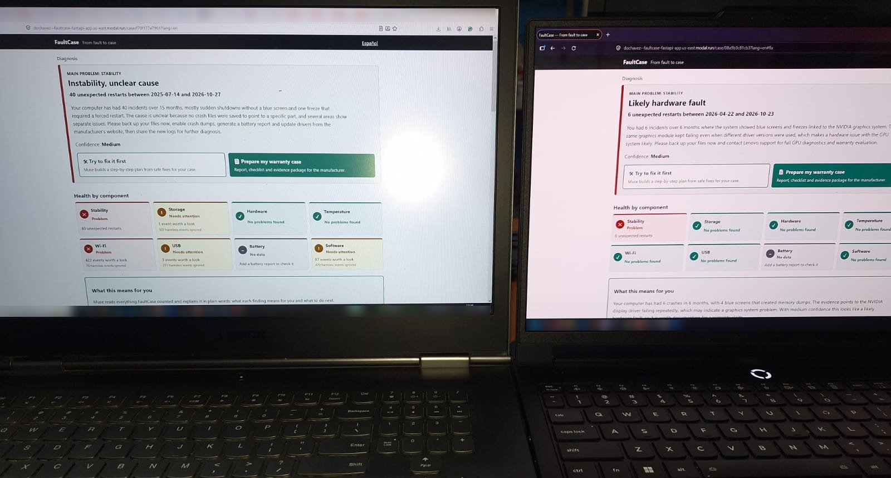

| ⬅️ Computadora de la izquierda | Computadora de la derecha ➡️ |
|---|---|
| El **segundo equipo**. Veredicto: **"Inestabilidad de causa incierta"**. 40 apagados inesperados en 15 meses, la mayoría sin código de error (24 de 39 seguidos de al menos una hora apagado, posiblemente por pérdida de energía), más errores del controlador Wi-Fi. | El **equipo principal**. Veredicto: **"Probable fallo de hardware"**. 6 fallos en 6 meses; los 4 volcados de memoria apuntan al controlador de pantalla de NVIDIA (`nvlddmkm.sys`), en dos versiones distintas del controlador. |

La misma herramienta, dos conclusiones distintas, cada una respaldada por su propia evidencia.

## Por qué ayuda Muse

La computadora es el equipo que la mayoría usa todos los días para trabajar y estudiar, así que cuando falla el costo es real: horas perdidas, archivos en riesgo y un proceso de soporte que pocos saben recorrer. El Visor de eventos ya guarda la evidencia, pero está escrito para ingenieros. Muse la convierte en decisiones:

| Beneficio | Cómo lo logra Muse | Qué gana el usuario |
|---|---|---|
| **Entender** | *Explicar con Muse* convierte los hechos contados en palabras sencillas, por componente, con un glosario de los términos técnicos | Sabe qué pasa sin leer códigos de error |
| **Decidir** | *Intentar solucionarlo primero* arma un plan solo con soluciones seguras y dice con honestidad cuándo lo probable es la garantía | No pierde días con arreglos que no pueden funcionar, ni manda a reparar un equipo cuando bastaba actualizar un controlador |
| **Actuar** | Muse Spark redacta un informe profesional para el fabricante en inglés y español, con cada incidente, código, controlador y paso ya intentado | Un solo mensaje con el que soporte puede actuar, en vez de idas y vueltas o un hilo anónimo en un foro |
| **Confiar** | Dos análisis independientes de Muse Spark Open (Baseten y Fireworks) deben coincidir; cada hallazgo se etiqueta como hecho o hipótesis; los conteos los hace Python, no el modelo | Una confianza ganada, nunca números inventados |
| **Rapidez** | Todo el proceso sale de una sola subida | Alrededor de un minuto en vez de una noche con el Visor de eventos y WinDbg |
| **Privacidad** | Los datos personales se eliminan antes de llamar a un modelo, los volcados de memoria nunca salen del equipo y los casos solo viven en memoria | Recibe ayuda de IA sin entregar datos personales |
| **Bajo costo** | Carga compacta y anonimizada (unos 9,5k tokens por análisis) y prompts en caché | El benchmark completo de 21 ejecuciones costó unos 1,92 USD, unos 9 centavos por caso |

## Pruébalo en 1 minuto

**Demostración en vivo:** [https://dochavez--faultcase-fastapi-app.us-east.modal.run/](https://dochavez--faultcase-fastapi-app.us-east.modal.run/)  
**Demostración de respaldo (Render):** [https://faultcase.onrender.com](https://faultcase.onrender.com)

Abre la URL de demostración y haz clic en **Try a sample case**: sin cuenta, sin código de invitación, instantáneo y gratis (el caso de demostración está precalculado; ver `scripts/build_demo_case.py`).

O ejecútalo localmente (Python 3.11, sin claves de API para la demo):

**Windows (PowerShell):**

```powershell
git clone https://github.com/dochavez/faultcase.git
cd faultcase
py -3.11 -m venv .venv
.venv\Scripts\Activate.ps1
pip install -r requirements.txt
copy .env.example .env   # fill in API keys only for new diagnoses, not for the demo
uvicorn faultcase.app:app --reload
```

**macOS / Linux:**

```bash
git clone https://github.com/dochavez/faultcase.git
cd faultcase
python3.11 -m venv .venv
source .venv/bin/activate
pip install -r requirements.txt
cp .env.example .env   # fill in API keys only for new diagnoses, not for the demo
uvicorn faultcase.app:app --reload
```

Después abre http://127.0.0.1:8000 y haz clic en **Try a sample case**.

<details>
<summary>Analiza tu propia laptop Windows</summary>

1. Abre la aplicación y haz clic en **Download device-diagnostics.xml** (paso 1 de la pantalla de recopilación).
2. En tu laptop: Visor de eventos → Acción → **Import Custom View…** → selecciona el archivo descargado.
3. Acción → **Save All Events in Custom View As…** → guarda el archivo `.evtx`.
4. De vuelta en la aplicación, sube el `.evtx` (máx. 20 MB) con tu código de invitación. Opcionalmente añade una exportación de msinfo32 (Windows + R → `msinfo32` → Archivo → Exportar), un informe de batería (`powercfg /batteryreport` en el Terminal), marca **Also analyze my memory dumps** si tienes `cdb.exe` y derechos de administrador, o deja que la aplicación lea los datos del equipo directamente en una ejecución local en Windows.
5. Lee el diagnóstico y abre la pantalla de acción para ver el informe para el fabricante (inglés/español), la lista de verificación previa al reclamo y el paquete de evidencias.

</details>

## Capturas de pantalla

**Recopilar**: etiqueta Windows 10/11, guía paso a paso del Visor de eventos con capturas, archivos obligatorios y opcionales, caso de ejemplo:

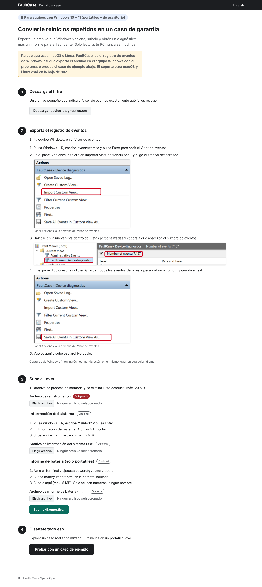

**Diagnóstico**: tarjeta del veredicto con el problema principal y dos caminos (*Intentar solucionarlo primero* o *Preparar mi caso de garantía*), 8 tarjetas de estado por componente, gráfico de reinicios por mes, línea de tiempo, *Explicar con Muse* y detalles técnicos para el técnico del fabricante:

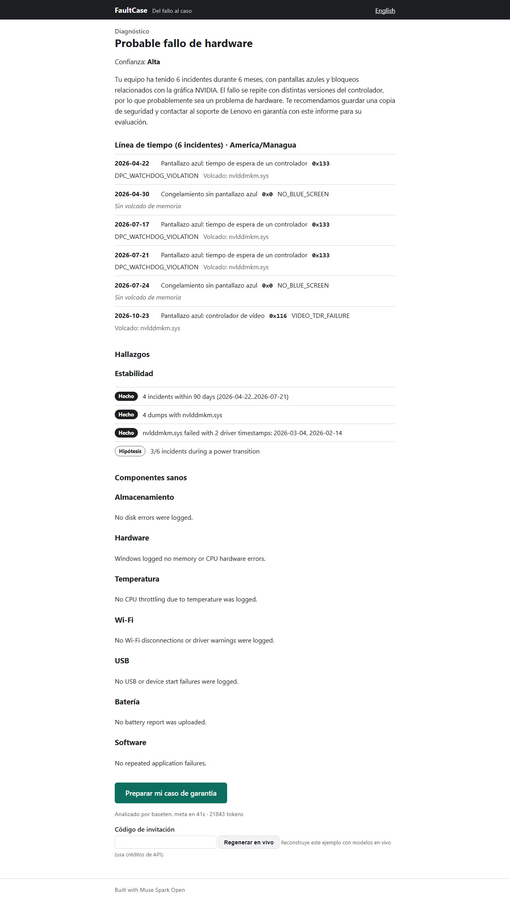

**Explicar con Muse**: a petición, Muse Spark convierte los hechos contados en palabras sencillas: qué significa cada hallazgo, qué hacer, próximos pasos y un glosario:

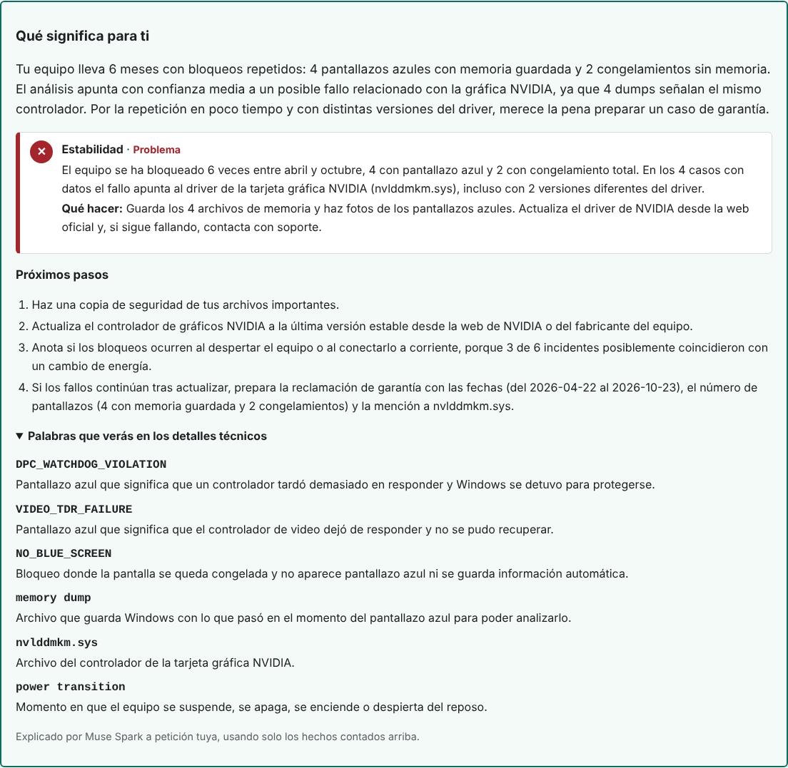

**Intentar solucionarlo primero**: a petición, Muse Spark convierte las soluciones seguras de los playbooks para los componentes con problemas en un plan ordenado (por qué, cómo, minutos, riesgo, cómo comprobar, cuándo parar). Cada paso trae un botón que abre la página exacta de Configuración de Windows o el sitio de soporte del fabricante. Cuando FaultCase se ejecuta localmente en el equipo, tres pasos además tienen **Aplicar en este equipo** (ver abajo). Los pasos marcados se añaden al informe para el fabricante en el navegador:

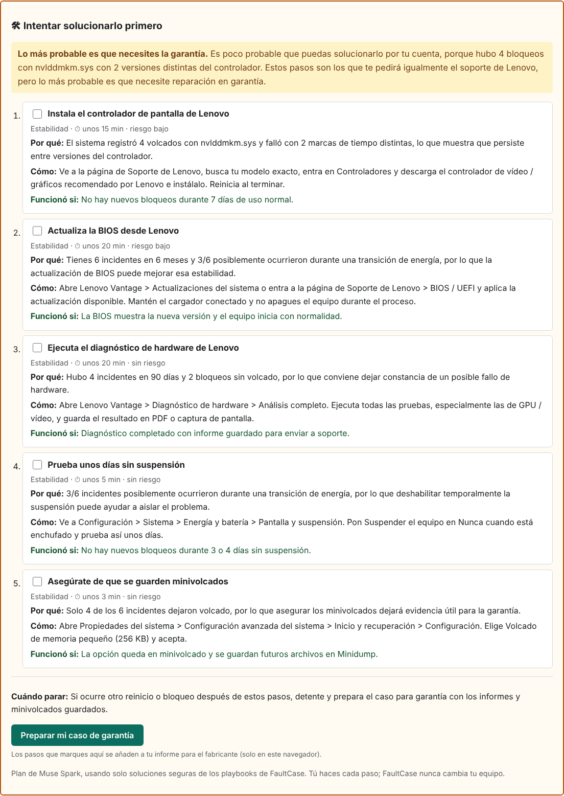

**Arreglos con un clic (solo en modo local).** La versión web nunca puede cambiar un equipo: un sitio web no tiene acceso a la configuración de Windows. Cuando FaultCase está instalado y se ejecuta localmente en el equipo con Windows (sigue usando Muse a través de la API), el plan agrega **Aplicar en este equipo** a tres ajustes seguros y reversibles:

| Arreglo | Qué cambia | Deshacer | Permisos |
|---|---|---|---|
| Suspensión desactivada para probar | Suspender después de "nunca", conectado y con batería (`powercfg /change`) | Restaura los tiempos anteriores | Usuario |
| Volcados de memoria pequeños | `CrashDumpEnabled = 3`, para que el próximo fallo deje evidencia | Restaura el valor anterior | Administrador |
| Ahorro de energía del Wi-Fi desactivado | Windows ya no puede apagar el adaptador Wi-Fi (`Set-NetAdapterPowerManagement`) | Restaura el estado anterior | Administrador |

Los comandos están fijos en `faultcase/adapters/windows/fixes.py`: Muse solo elige qué paso corresponde, nunca escribe ni ejecuta un comando. Cada cambio pide confirmación, guarda el valor anterior en `%LOCALAPPDATA%\FaultCase\fix-backup.json` y se puede deshacer. Las peticiones deben venir de `127.0.0.1` con un token secreto por ejecución, para que otros sitios web no puedan activar un arreglo. Los controladores y la BIOS nunca se instalan automáticamente: esos botones abren la página del fabricante.

**Acción**: qué hacer ahora (con el enlace de soporte del fabricante), informe EN/ES, lista previa, ZIP de evidencias y número de serie rellenado solo en el navegador:

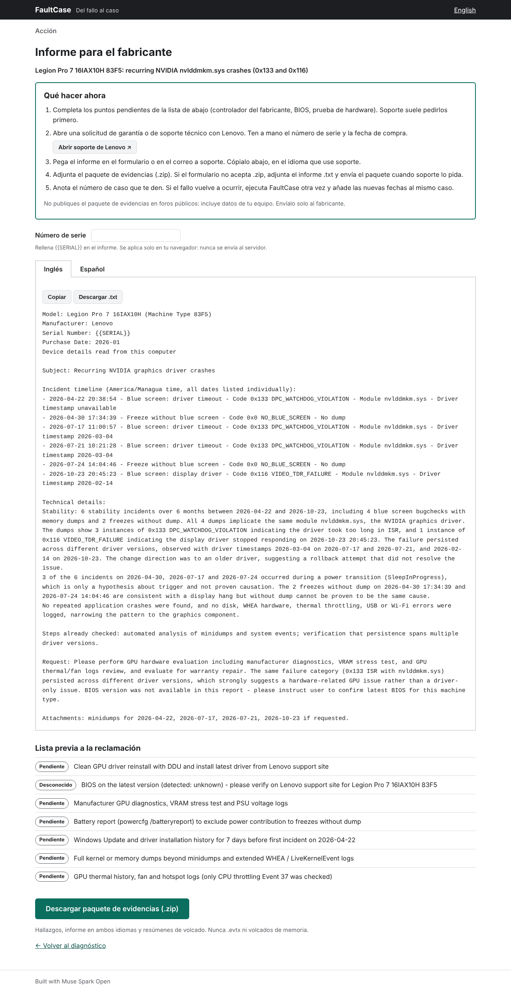

Versiones en inglés: [collect-en.png](docs/img/collect-en.png), [diagnosis-en.png](docs/img/diagnosis-en.png), [explain-en.png](docs/img/explain-en.png), [fix-en.png](docs/img/fix-en.png), [action-en.png](docs/img/action-en.png). Se regeneran con `python scripts/screenshots.py` (herramientas de desarrollo: `pip install playwright pillow` y `playwright install chromium`; solo el caso de ejemplo, sin llamadas a modelos).

## Cómo funciona

Tres pantallas (FastAPI + Jinja2 + HTMX, inglés/español): **recopila** la evidencia, lee el **diagnóstico** y actúa en la pantalla de **acción**. Python hace todos los conteos; los modelos de Meta solo interpretan y redactan.

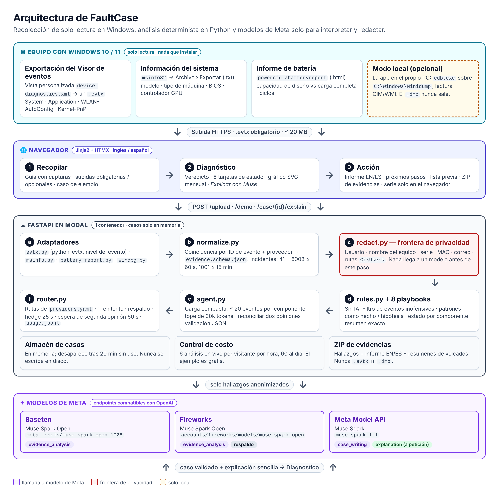

Lo que hace el núcleo determinista antes de llamar a cualquier modelo:

- **Lee** cada registro con `python-evtx`, incluido el nivel del evento de Windows (crítico, error, advertencia, información).
- **Normaliza** contra 8 playbooks (`playbooks/*.yaml`): estabilidad, almacenamiento, hardware, temperatura, Wi-Fi, USB, batería y software. Solo los eventos de estabilidad forman incidentes: 41 y 6008 a menos de 60 s, y un informe 1001 a menos de 15 min de su 41.
- **Ignora ruido conocido** con reglas explícitas: dispositivos virtuales de Hyper-V o de software (`ROOT\`, `SWD\`), el controlador WUDFRd, el evento 6062 del Wi-Fi Intel, desconexiones de Wi-Fi iniciadas por el usuario o el sistema, NTFS 98 informativo, corrupción en copias de sombra de volumen y actualizaciones correctas.
- **Calcula** patrones etiquetados como `fact` o `hypothesis`, un estado por componente (problema, requiere atención, sin problemas, sin datos) y un resumen exacto (incidentes, fechas, meses, volcados, dirección del controlador).
- **Compacta** la carga: por componente, conteos y como máximo 20 eventos representativos anonimizados, con un tope de 30k tokens.

En la exportación real anonimizada esto convierte 7.159 eventos en una petición de ~9,5k tokens:

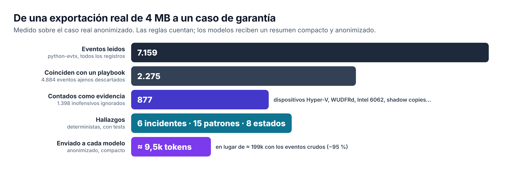

Una subida, de principio a fin:

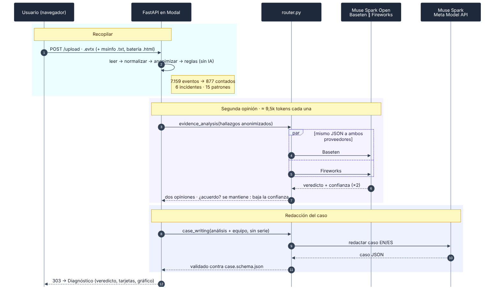

## Modelos y proveedores

| Rol | Modelo | Proveedor |
|---|---|---|
| Análisis técnico de la evidencia | Muse Spark Open | Baseten y Fireworks en paralelo (segunda opinión) |
| Redacción del caso EN/ES y resumen para el usuario | Muse Spark (`muse-spark-1.1`) | Meta Model API (Fireworks de respaldo) |
| *Explicar con Muse*: explicación sencilla a petición | Muse Spark (`muse-spark-1.1`) | Meta Model API (Fireworks de respaldo) |
| *Intentar solucionarlo primero*: plan de autoayuda con las soluciones seguras de los playbooks, a petición | Muse Spark (`muse-spark-1.1`) | Meta Model API (Fireworks de respaldo) |
| Construcción de este proyecto | Muse Code | Terminal |

Las rutas viven en `config/providers.yaml`: `evidence_analysis: [baseten, fireworks]`, `case_writing: [meta, fireworks]`, `explanation: [meta, fireworks]`, `fix_plan: [meta, fireworks]`.

- **Segunda opinión.** Ambos proveedores de pesos abiertos analizan los mismos hallazgos redactados al mismo tiempo. Si el veredicto y la confianza coinciden, se conservan; si difieren, la confianza baja un nivel y se añade un hallazgo de tipo `hypothesis`. Si un proveedor falla, o responde más de 60 s después del primero (`second_opinion_wait_seconds`), se continúa con la opinión disponible. Se alterna con `analysis_mode: second_opinion | single`.
- **Caché de prompts.** Cada solicitud pone primero el contenido estático (prompt del sistema, reglas de playbooks, claves de salida) y los datos del caso al final, para que los proveedores reutilicen los prefijos en caché. Los tokens en caché se leen de `usage.prompt_tokens_details` y se registran en `logs/usage.jsonl`.
- **Solicitudes de cobertura (hedged).** Si el proveedor principal tarda más de `hedge_after_seconds` (25 por defecto), se inicia el siguiente proveedor y gana la primera respuesta válida; una línea `hedge` registra al ganador.
- **Esfuerzo de razonamiento por rol.** `medium` en ambos roles (omitido para el análisis en Baseten, cuya generación restringida se bloquea con él); los parámetros rechazados se reintentan una vez sin ellos y se recuerdan durante la sesión.
- **Límites de completado.** `max_tokens` por rol (16384 análisis, 24576 redacción, 8192 explicación y plan de solución; los dos primeros medidos desde los completados exitosos más grandes más un margen). `finish_reason == "length"` se registra como `truncated` y se reintenta una vez.

### Benchmark (medido el 2026-11-02)

`scripts/benchmark.py` ejecuta `build_case` 3 veces en el caso real más 6 casos sintéticos (`fixtures/synthetic/`: laptop sana, fallo de disco, fallo aislado, Wi-Fi, USB, batería). Resultados completos: [docs/benchmark.md](docs/benchmark.md).

| Provider | Role | Calls ok/total | Correct | p50 ms | p95 ms | Prompt | Compl | Cached | Est. cost | Fallbacks | Hedge wins |
| --- | --- | --- | --- | --- | --- | --- | --- | --- | --- | --- | --- |
| baseten | evidence_analysis | 21/21 | 100% (21/21) | 19975 | 26104 | 46611 | 59619 | 28928 | $0.5268 | 0 | 0 |
| fireworks | evidence_analysis | 21/21 | 100% (21/21) | 16465 | 31516 | 46590 | 36432 | 32128 | $0.3364 | 0 | 0 |
| meta | case_writing | 21/21 | 100% (21/21) | 12347 | 16926 | 50314 | 80466 | 26467 | $1.0570 | 0 | 0 |

Tasa de acuerdo de la segunda opinión: **71%** (15/21 ejecuciones con dos opiniones). Totales: 21 ejecuciones, 0 coberturas, $1.9202 estimados (precios de ejemplo en `config/providers.yaml`).

<details>
<summary>Cómo se juzga la corrección</summary>

El veredicto final del caso real debe estar en `acceptable_verdicts` de `fixtures/real_case/expected.json`. Cada otro veredicto acierta cuando contiene una palabra clave esperada (sin distinguir mayúsculas); las listas de palabras clave viven en `fixtures/synthetic/*.json`. Solo se guardan veredictos y métricas, nunca claves de API ni datos personales.

</details>

## Cómo trabajan juntos Muse, Baseten y Fireworks

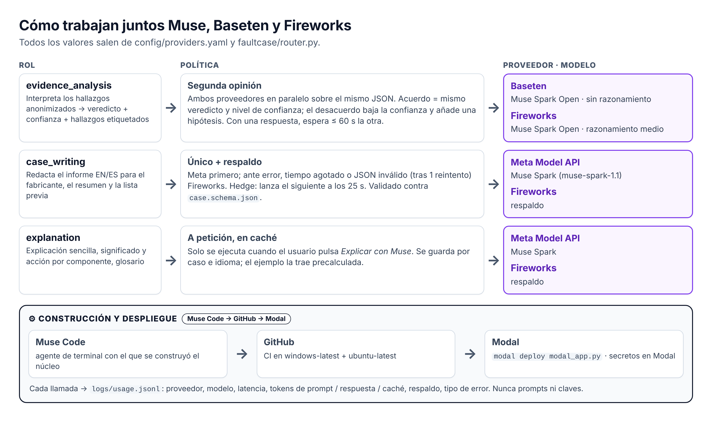

*Explicar con Muse*, a petición y en caché:

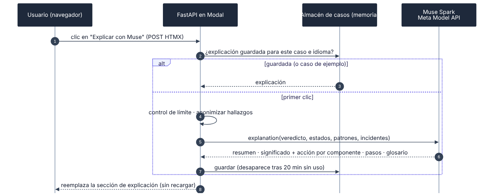

Resiliencia: qué pasa en cada fallo y qué ve el usuario:

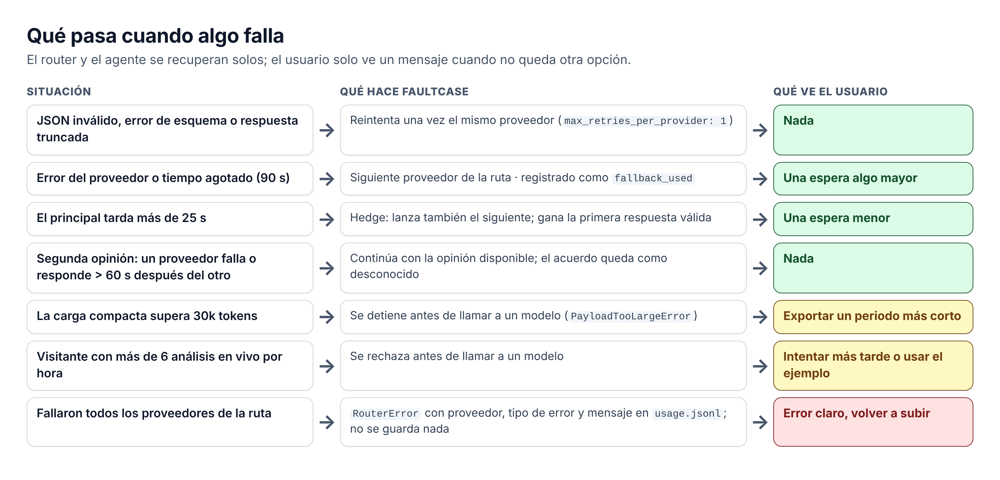

Fuentes de los diagramas: `docs/diagrams/` (se regeneran con `python docs/diagrams/build_diagrams.py` y `mmdc`).

## Cómo se construyó con Muse Code

Muse Code (el agente de terminal impulsado por Muse Spark, modelo `muse-spark-1.3-contributor`) construyó el núcleo de FaultCase. Su propio registro de sesión guarda **31 ejecuciones** (26 completadas), **1.009 llamadas a herramientas**, unas **5,3 horas** de trabajo del agente y **50 de los 63 commits**. Todos los números salen de ese registro (`~/.local/share/muse/sessions/.../session.jsonl`), extraídos con `docs/diagrams/build_muse_evidence.py`.

### Cómo se conectan los archivos y llaman a las APIs

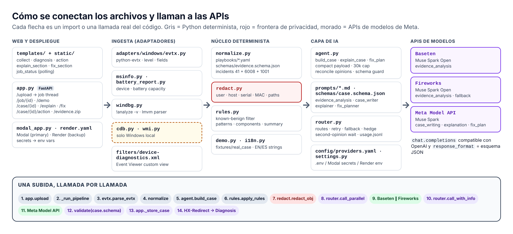

### Ocho prompts reales y las respuestas de Muse Code

| # | Tarea dada a Muse Code | Respuesta de Muse Code (primera línea) | Duración | Llamadas a herramientas |
|---|---|---|---|---|
| 1 | [Entorno y esqueleto del paquete](docs/img/muse-code/run-1.png) | Done. Environment is set up and committed as `bf8c73d` ("Set up environment and package skeleton"). | 11.5 min | 28 |
| 2 | [Adaptador de Windows: parsers de evtx y WinDbg](docs/img/muse-code/run-2.png) | Done — `pytest` passes (6/6) and committed as `c8b765c`. | 2.7 min | 36 |
| 3 | [Normalización y anonimización](docs/img/muse-code/run-3.png) | Done — `pytest` passes (11/11) and committed as `723de43`. | 2.9 min | 20 |
| 4 | [Router de modelos con respaldo](docs/img/muse-code/run-4.png) | Done — `pytest` passes (30/30) and committed as `3ca3e26`. | 2.8 min | 11 |
| 5 | [Correcciones de auditoría: demo, zona horaria, privacidad](docs/img/muse-code/run-5.png) | All six fixes are done, committed one per item, and pushed (`99b012c..bbaa6b6`). Final `pytest`: 66 passed, 1 live deselected. | 27.6 min | 108 |
| 6 | [Identificación automática del equipo](docs/img/muse-code/run-6.png) | All five steps done, `pytest` green (95 passed, 1 skipped), and pushed (`06f3ed2..f597b9d`). Commits: parser, Collect upload, CIM reading, serial field, report content. | 23.2 min | 67 |
| 7 | [Segunda opinión, caché, hedge y benchmark](docs/img/muse-code/run-7.png) | All five items done, 116 tests green, pushed (`f597b9d..aaf89fd`), one commit per item. | 23.6 min | 102 |
| 8 | [Playbooks de Wi-Fi, USB y batería](docs/img/muse-code/run-8.png) | All six items done, 155 tests green, pushed (`60d9e45..c52fbf0`), one commit per item. | 50.5 min | 214 |

Cada tarjeta muestra el prompt exacto, la respuesta final de Muse Code, el modelo, la duración, las llamadas a herramientas y los tokens, generada desde el registro de sesión (no reescrita). Los prompts y respuestas completos están en [docs/muse-code/EVIDENCE.md](docs/muse-code/EVIDENCE.md) (en inglés, como se escribieron) y el extracto en [docs/muse-code/runs.json](docs/muse-code/runs.json).

<details>
<summary>Evidencia: las ocho ejecuciones tal como las registró Muse Code</summary>

**1. Entorno y esqueleto del paquete**

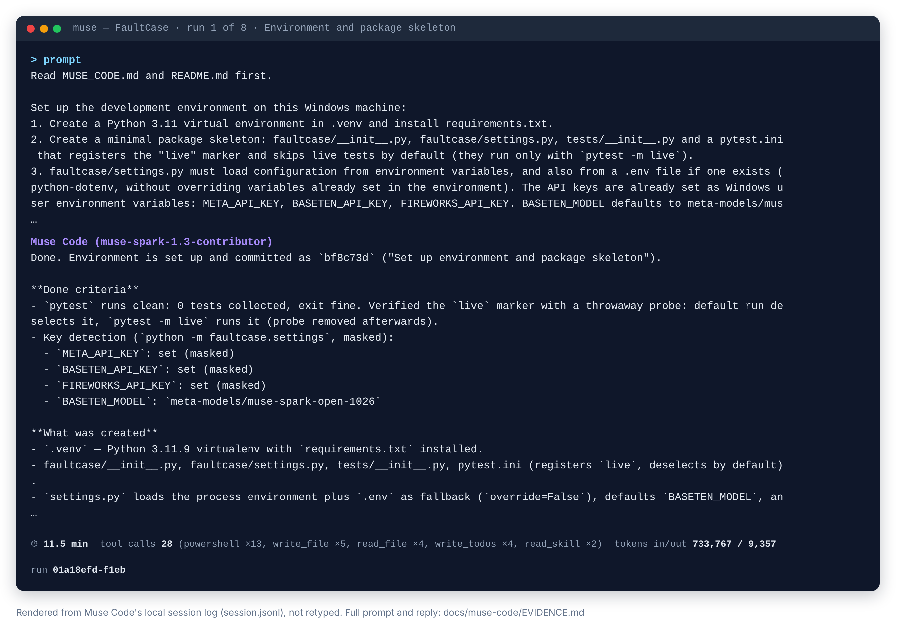

**2. Adaptador de Windows: parsers de evtx y WinDbg**

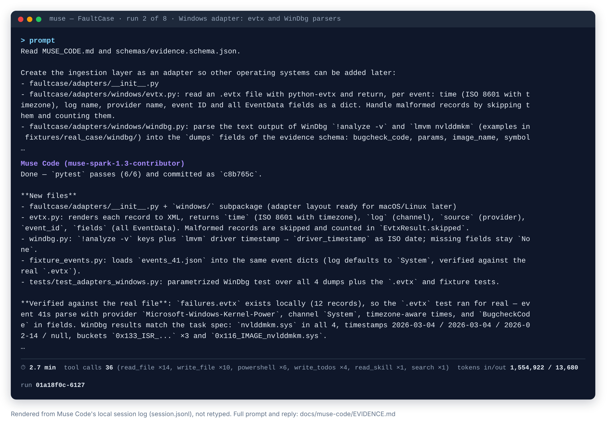

**3. Normalización y anonimización**

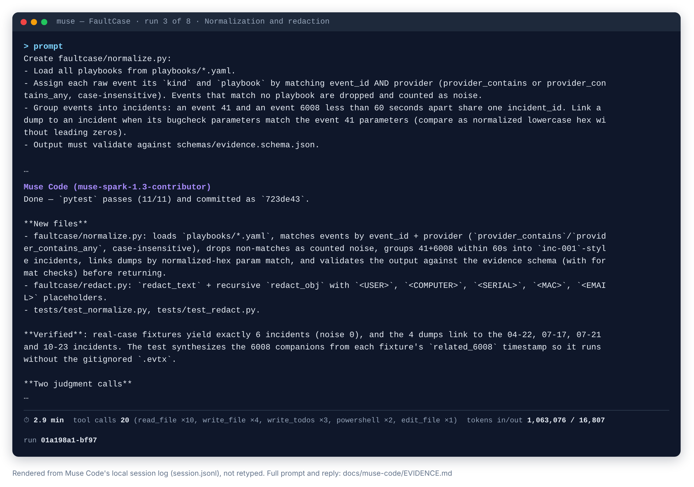

**4. Router de modelos con respaldo**

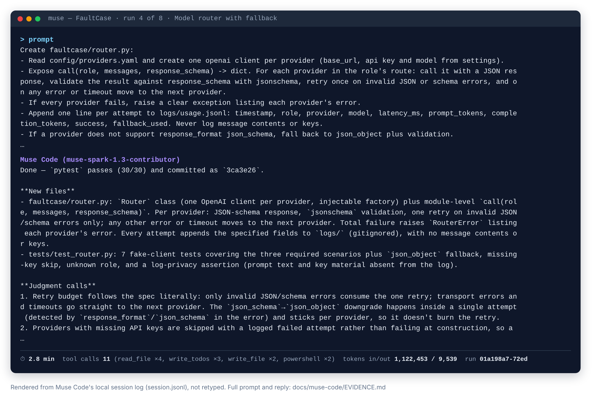

**5. Correcciones de auditoría: demo, zona horaria, privacidad**

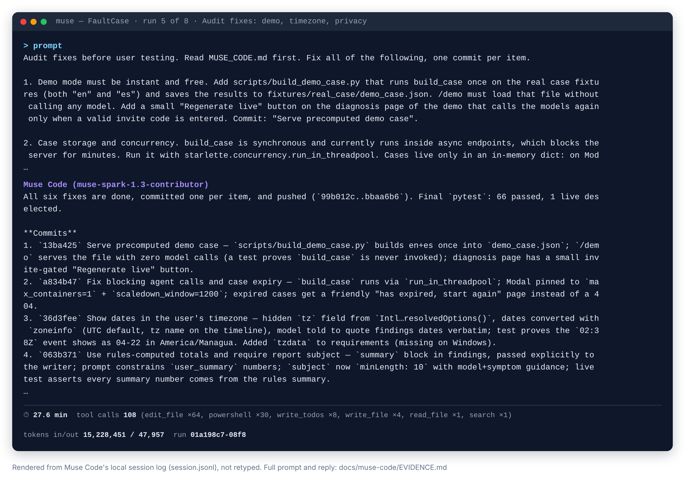

**6. Identificación automática del equipo**

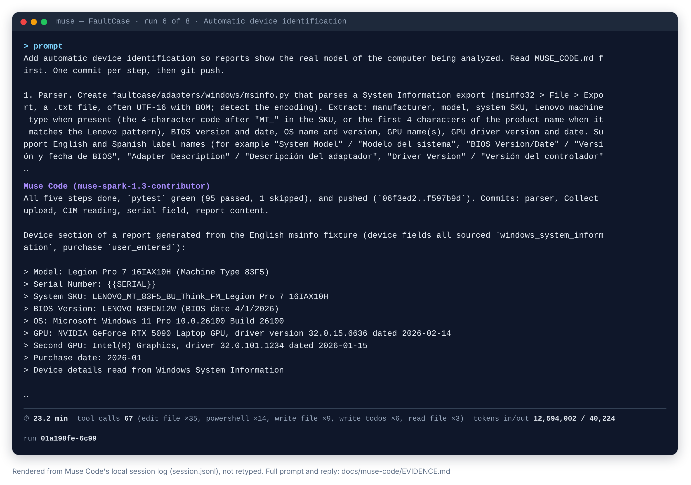

**7. Segunda opinión, caché, hedge y benchmark**

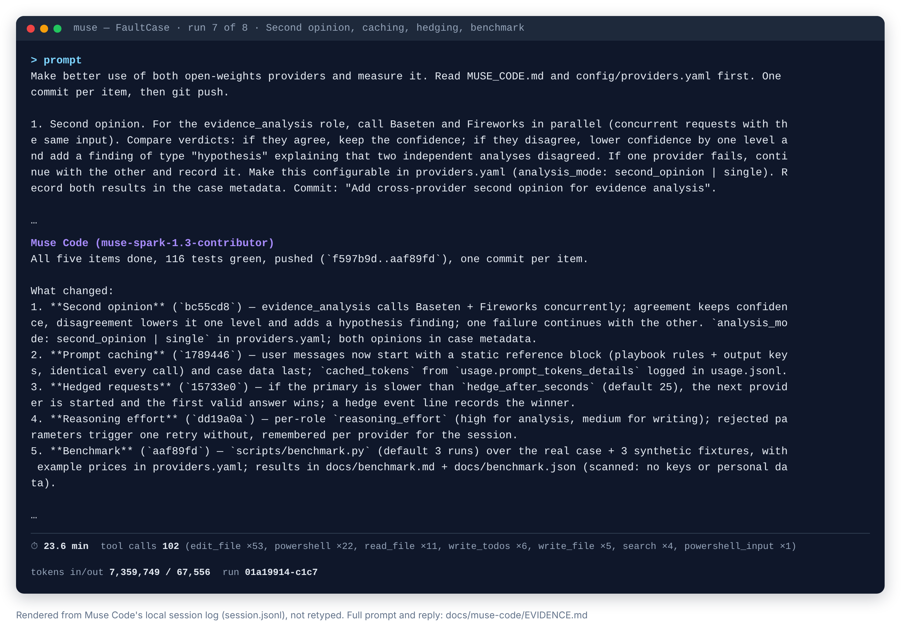

**8. Playbooks de Wi-Fi, USB y batería**

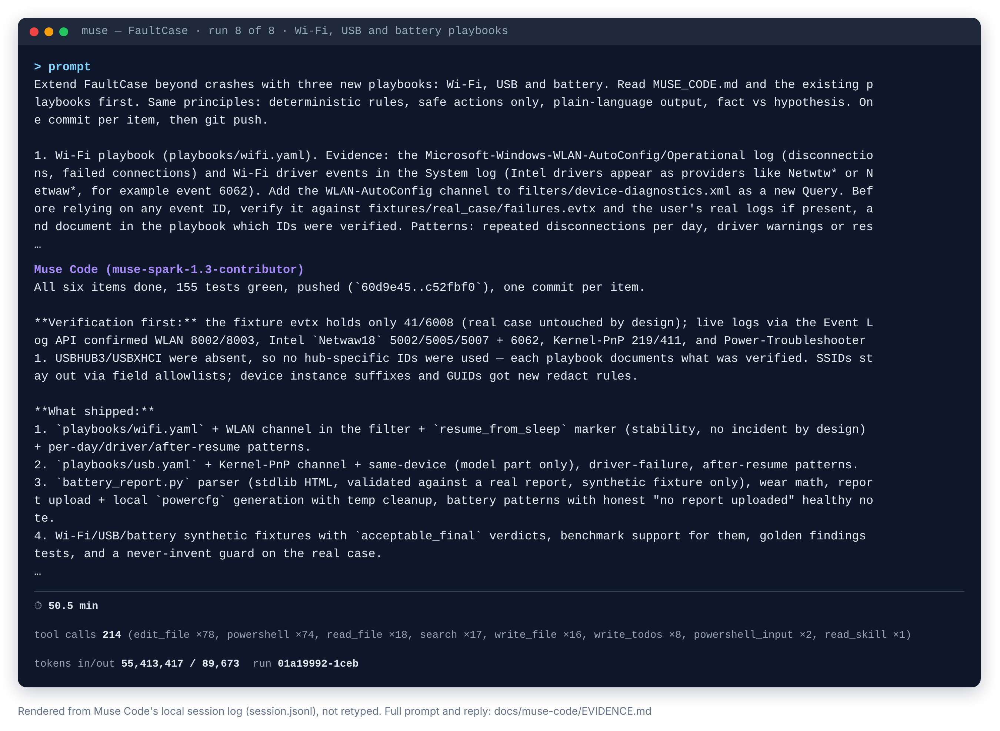

</details>

La **regla de la prueba dorada** mantuvo honesto al agente: `fixtures/real_case/expected.json` define las conclusiones que el sistema debe alcanzar y nunca debe editarse para que las pruebas pasen (`tests/test_real_case.py` verifica cada campo; la prueba en vivo verifica el veredicto, la confianza y las afirmaciones prohibidas).

### Historial de commits

El repositorio es público, así que cualquiera puede revisar cada commit, sus cambios y su fecha en GitHub: [github.com/dochavez/faultcase/commits/main](https://github.com/dochavez/faultcase/commits/main). ✓ marca los commits que hizo el propio Muse Code (sus llamadas a `git commit` están en el registro de sesión); los que no tienen marca se hicieron fuera de Muse Code.

<details>
<summary>Los 63 commits al momento de escribir esto</summary>

| # | Commit | Mensaje | Muse Code |
|---|---|---|---|
| 1 | [`baa30dd`](https://github.com/dochavez/faultcase/commit/baa30dd) | Initial FaultCase kit |  |
| 2 | [`bf8c73d`](https://github.com/dochavez/faultcase/commit/bf8c73d) | Set up environment and package skeleton | ✓ |
| 3 | [`a58ac1e`](https://github.com/dochavez/faultcase/commit/a58ac1e) | Add provider smoke test | ✓ |
| 4 | [`c8b765c`](https://github.com/dochavez/faultcase/commit/c8b765c) | Add Windows adapter: evtx and WinDbg parsers | ✓ |
| 5 | [`723de43`](https://github.com/dochavez/faultcase/commit/723de43) | Add normalization and redaction | ✓ |
| 6 | [`b673bbb`](https://github.com/dochavez/faultcase/commit/b673bbb) | Add rules engine and golden real-case test | ✓ |
| 7 | [`3ca3e26`](https://github.com/dochavez/faultcase/commit/3ca3e26) | Add model router with fallback | ✓ |
| 8 | [`e462f40`](https://github.com/dochavez/faultcase/commit/e462f40) | Add case-building agent | ✓ |
| 9 | [`3d3bbc2`](https://github.com/dochavez/faultcase/commit/3d3bbc2) | Add three-screen web app | ✓ |
| 10 | [`cf17104`](https://github.com/dochavez/faultcase/commit/cf17104) | Add Modal deployment | ✓ |
| 11 | [`99b012c`](https://github.com/dochavez/faultcase/commit/99b012c) | Add local minidump analysis | ✓ |
| 12 | [`13ba425`](https://github.com/dochavez/faultcase/commit/13ba425) | Serve precomputed demo case | ✓ |
| 13 | [`a834b47`](https://github.com/dochavez/faultcase/commit/a834b47) | Fix blocking agent calls and case expiry | ✓ |
| 14 | [`36d3fee`](https://github.com/dochavez/faultcase/commit/36d3fee) | Show dates in the user timezone | ✓ |
| 15 | [`063b371`](https://github.com/dochavez/faultcase/commit/063b371) | Use rules-computed totals and require report subject | ✓ |
| 16 | [`b414454`](https://github.com/dochavez/faultcase/commit/b414454) | Make cdb tests portable | ✓ |
| 17 | [`bbaa6b6`](https://github.com/dochavez/faultcase/commit/bbaa6b6) | Exclude private evtx from Modal image | ✓ |
| 18 | [`da2add9`](https://github.com/dochavez/faultcase/commit/da2add9) | Fix cdb tests on non-Windows platforms | ✓ |
| 19 | [`35f9edc`](https://github.com/dochavez/faultcase/commit/35f9edc) | Fix incident period calculation | ✓ |
| 20 | [`ce27539`](https://github.com/dochavez/faultcase/commit/ce27539) | Remove internal identifiers from manufacturer report | ✓ |
| 21 | [`082c228`](https://github.com/dochavez/faultcase/commit/082c228) | Polish Spanish and add plain-language incident labels | ✓ |
| 22 | [`82ae9dc`](https://github.com/dochavez/faultcase/commit/82ae9dc) | Rewrite README for judges | ✓ |
| 23 | [`248c007`](https://github.com/dochavez/faultcase/commit/248c007) | Add device model and full incident list to report | ✓ |
| 24 | [`06f3ed2`](https://github.com/dochavez/faultcase/commit/06f3ed2) | Describe driver version changes accurately | ✓ |
| 25 | [`5392efa`](https://github.com/dochavez/faultcase/commit/5392efa) | Add msinfo32 export parser | ✓ |
| 26 | [`ca021fb`](https://github.com/dochavez/faultcase/commit/ca021fb) | Add msinfo upload and manual device fields | ✓ |
| 27 | [`c3a3812`](https://github.com/dochavez/faultcase/commit/c3a3812) | Read device details locally with CIM queries | ✓ |
| 28 | [`ef0cb2e`](https://github.com/dochavez/faultcase/commit/ef0cb2e) | Add browser-only serial number field | ✓ |
| 29 | [`f597b9d`](https://github.com/dochavez/faultcase/commit/f597b9d) | Show device details and BIOS checklist in report | ✓ |
| 30 | [`bc55cd8`](https://github.com/dochavez/faultcase/commit/bc55cd8) | Add cross-provider second opinion for evidence analysis | ✓ |
| 31 | [`1789446`](https://github.com/dochavez/faultcase/commit/1789446) | Order prompts for caching and log cached tokens | ✓ |
| 32 | [`15733e0`](https://github.com/dochavez/faultcase/commit/15733e0) | Add hedged requests | ✓ |
| 33 | [`dd19a0a`](https://github.com/dochavez/faultcase/commit/dd19a0a) | Configure reasoning effort per role | ✓ |
| 34 | [`aaf89fd`](https://github.com/dochavez/faultcase/commit/aaf89fd) | Add provider benchmark and results | ✓ |
| 35 | [`bc56b7e`](https://github.com/dochavez/faultcase/commit/bc56b7e) | Compare second opinions on enum verdicts | ✓ |
| 36 | [`289912f`](https://github.com/dochavez/faultcase/commit/289912f) | Cap completion length and detect truncation | ✓ |
| 37 | [`7c2a89c`](https://github.com/dochavez/faultcase/commit/7c2a89c) | Make Baseten analysis reliable | ✓ |
| 38 | [`6a6aafd`](https://github.com/dochavez/faultcase/commit/6a6aafd) | Refresh benchmark results and demo case | ✓ |
| 39 | [`2b21606`](https://github.com/dochavez/faultcase/commit/2b21606) | Add screenshot script and images | ✓ |
| 40 | [`fd947de`](https://github.com/dochavez/faultcase/commit/fd947de) | Add README banner | ✓ |
| 41 | [`5c98489`](https://github.com/dochavez/faultcase/commit/5c98489) | Add CI workflow | ✓ |
| 42 | [`c73a72f`](https://github.com/dochavez/faultcase/commit/c73a72f) | Write final README | ✓ |
| 43 | [`284af58`](https://github.com/dochavez/faultcase/commit/284af58) | Add Spanish README | ✓ |
| 44 | [`632a675`](https://github.com/dochavez/faultcase/commit/632a675) | Add integration diagrams | ✓ |
| 45 | [`60d9e45`](https://github.com/dochavez/faultcase/commit/60d9e45) | Update MUSE_CODE layout | ✓ |
| 46 | [`eaf9b3f`](https://github.com/dochavez/faultcase/commit/eaf9b3f) | Add Wi-Fi playbook with verified event IDs | ✓ |
| 47 | [`870c344`](https://github.com/dochavez/faultcase/commit/870c344) | Add USB playbook with verified event IDs | ✓ |
| 48 | [`4381749`](https://github.com/dochavez/faultcase/commit/4381749) | Add battery playbook, parser and upload | ✓ |
| 49 | [`36acb22`](https://github.com/dochavez/faultcase/commit/36acb22) | Add component fixtures, benchmark cases and golden tests | ✓ |
| 50 | [`8152610`](https://github.com/dochavez/faultcase/commit/8152610) | Group diagnosis by component, report sections per component | ✓ |
| 51 | [`c52fbf0`](https://github.com/dochavez/faultcase/commit/c52fbf0) | Refresh benchmark, demo, screenshots and docs for new components | ✓ |
| 52 | [`13d1f68`](https://github.com/dochavez/faultcase/commit/13d1f68) | Compact model payload, stability-only incidents, benign-event rules and visual diagnosis |  |
| 53 | [`245f4ee`](https://github.com/dochavez/faultcase/commit/245f4ee) | Calibrate rules on a real export, AI component notes, next steps, localized file pickers, wider layout |  |
| 54 | [`de72d48`](https://github.com/dochavez/faultcase/commit/de72d48) | On-demand plain-language explanation with Muse Spark, glossary, live demo URL |  |
| 55 | [`8b54039`](https://github.com/dochavez/faultcase/commit/8b54039) | Windows-only notice and screenshot guide for Event Viewer export |  |
| 56 | [`f23236d`](https://github.com/dochavez/faultcase/commit/f23236d) | Say Windows 10 and 11 computers, not only laptops |  |
| 57 | [`0f38e4c`](https://github.com/dochavez/faultcase/commit/0f38e4c) | Refresh README screenshots and diagrams, Muse Code table without dates, FAQ |  |
| 58 | [`1e3cfe8`](https://github.com/dochavez/faultcase/commit/1e3cfe8) | Try to fix it first with Muse, upload validation, keep-tab-open notice, new screenshots |  |
| 59 | [`ad7bd90`](https://github.com/dochavez/faultcase/commit/ad7bd90) | Try to fix it first, upload validation, keep-tab-open notice, Render blueprint |  |
| 60 | [`da5e02f`](https://github.com/dochavez/faultcase/commit/da5e02f) | Disable SDK silent retries, Render starter plan, backup demo URL |  |
| 61 | [`7bbafa4`](https://github.com/dochavez/faultcase/commit/7bbafa4) | Release the leave-page guard before redirecting to Diagnosis |  |
| 62 | [`32192b8`](https://github.com/dochavez/faultcase/commit/32192b8) | Run uploads as background jobs with real progress polling |  |
| 63 | [`efa15a7`](https://github.com/dochavez/faultcase/commit/efa15a7) | README: inspiration photos, any-brand note, why Muse helps, disclaimer |  |

</details>

## Privacidad y seguridad

Cada garantía está respaldada por una prueba:

| Garantía | Respaldada por |
|---|---|
| Nombres de usuario y de equipo, MACs y correos eliminados del texto | `test_redact_text_removes_personal_data` |
| Ningún dato personal ni número de serie llega a los modelos | `test_personal_data_and_serial_never_reach_models` |
| El número de serie se sustituye localmente, solo si se proporciona | `test_serial_replaced_locally_only_when_provided` |
| El campo web de número de serie nunca envía nada al servidor | `test_serial_canary_never_reaches_server` |
| Las cargas de datos del equipo se redactan antes de usarse | `test_build_device_redacts_personal_data` |
| El ZIP de evidencias nunca contiene `.evtx`/`.dmp` crudos | `test_demo_flow_uses_precomputed_file` |
| Los modelos reciben conteos y ≤ 20 eventos por componente, nunca el registro crudo (tope de 30k tokens) | `test_twenty_thousand_events_fit_the_token_budget` |
| *Explicar con Muse* recibe solo hallazgos anonimizados | `test_explain_case_sends_only_redacted_findings` |
| *Intentar solucionarlo primero* solo adapta soluciones seguras de los componentes con problemas | `test_fix_plan_uses_only_safe_fixes_of_involved_components` |
| Los eventos inofensivos conocidos nunca cuentan como fallos | `test_known_benign_events_are_not_counted` |
| Los identificadores de cubo de fallo se eliminan del informe | `test_strip_bucket_ids_from_reports` |
| Solo los campos analizados salen del análisis local de volcados | `test_analyze_dump_returns_only_parsed_fields` |
| El registro de uso nunca guarda prompts ni claves | `test_baseten_fails_fireworks_answers` |

Además: el análisis es de solo lectura (solo los arreglos opcionales con un clic en modo local cambian un ajuste, con confirmación y opción de deshacer), cargas procesadas en memoria o en una carpeta temporal y eliminadas justo después, y claves de API enmascaradas a sus últimos 4 caracteres dondequiera que se muestren.

## Decisiones de diseño

- **Primero las reglas deterministas.** Los conteos, fechas, códigos y patrones se calculan en Python con `rules.py` desde `playbooks/*.yaml`. Los modelos interpretan y redactan; nunca cuentan ni inventan datos.
- **Salida estructurada.** Cada respuesta de un modelo se valida contra un esquema JSON; si falla, el enrutador reintenta una vez y pasa al siguiente proveedor.
- **No es un chatbot.** Tres pantallas, un flujo: recopilación → diagnóstico → acción. Sin conversación abierta.
- **No analiza imágenes.** La evidencia son registros de eventos, resúmenes de volcados e información del sistema, nunca fotos.
- **Hecho frente a hipótesis.** Cada conclusión lleva su etiqueta; la correlación con transiciones de energía, por ejemplo, siempre es una hipótesis.
- **El usuario decide y envía.** El producto prepara evidencias y borradores; no da asesoría legal.

## Limitaciones

- Solo Windows 10 y 11 (portátiles y de escritorio). `faultcase/adapters/` solo tiene `windows/`; Linux y macOS necesitan sus propios adaptadores y playbooks, no solo instrucciones. La app se lo avisa a quien entra desde macOS o Linux.
- Un `.evtx` sin volcados de memoria da un caso más débil (los congelamientos sin volcado se reportan como tales).
- Los hallazgos de Wi-Fi y USB necesitan una exportación hecha con el filtro actual (canales WLAN-AutoConfig y Kernel-PnP); las exportaciones antiguas simplemente muestran esos componentes como sanos.
- Los hallazgos de batería necesitan el HTML de `powercfg /batteryreport` (subido, o generado localmente en Windows); sin él, el informe lo dice.
- El mismo cubo o hash de fallo significa la misma *categoría* de fallo; no prueba el mismo defecto que en otras máquinas (una prueba en vivo afirma que el texto nunca dice eso).
- Los casos viven en memoria: un reinicio o 20 minutos sin uso los borra (a propósito, por privacidad).
- La salida en vivo de los modelos varía entre ejecuciones; la demo está precalculada para ser instantánea, gratis y estable.

## Estructura del proyecto

```
faultcase/                 # Paquete Python
  adapters/windows/        # evtx, windbg, fixture_events, msinfo, wmi, cdb (solo local)
  app.py                   # FastAPI, 3 pantallas + /demo
  agent.py                 # hallazgos → análisis (Baseten/Fireworks) → caso (Meta)
  normalize.py             # eventos crudos → schemas/evidence.schema.json
  redact.py                # eliminación de datos personales
  rules.py                 # playbooks → hallazgos deterministas
  router.py                # proveedores con respaldo, cobertura y registro de uso
  demo.py / i18n.py        # demo precalculada, cadenas EN/ES
templates/ static/         # páginas Jinja2, CSS, capturas de la guía del Visor de eventos
config/                    # providers.yaml (rutas, roles, precios)
filters/ playbooks/        # device-diagnostics.xml; disk/hardware/software/stability/thermal/wifi/usb/battery
prompts/ schemas/          # evidence_analysis.md, case_writer.md, explainer.md, fix_planner.md; esquemas evidence/case
fixtures/                  # real_case/, synthetic/, msinfo/
scripts/                   # smoke_test.py, build_demo_case.py, benchmark.py, screenshots.py
tests/                     # suite pytest (las pruebas en vivo necesitan claves)
docs/                      # benchmark.md/.json, img/, diagrams/ (fuentes)
modal_app.py               # despliegue en Modal (principal)
render.yaml                # Blueprint de Render (despliegue de respaldo)
```

## Ejecutar las pruebas

```bash
pytest            # suite completa, sin red ni claves de API
pytest -m live    # construye el caso real con modelos reales (necesita claves en .env)
```

## Configuración

`.env` (ver `.env.example`): `META_API_KEY`, `BASETEN_API_KEY`, `FIREWORKS_API_KEY`, `BASETEN_MODEL` (por defecto `meta-models/muse-spark-open-1026`), `INVITE_CODE` (opcional: si existe, las cargas y la regeneración de la demo lo piden; si está vacío el campo no aparece y los análisis en vivo se limitan con `UPLOADS_PER_HOUR`, 6 por visitante por defecto, y `UPLOADS_PER_DAY`, 60 por defecto).

<details>
<summary>Referencia de <code>config/providers.yaml</code></summary>

- `providers.*`: `base_url`, `api_key_env`, `model`/`model_env`, precios de ejemplo `price_per_1k_*`.
- `routes`: `evidence_analysis: [baseten, fireworks]`, `case_writing: [meta, fireworks]`, `explanation: [meta, fireworks]`, `fix_plan: [meta, fireworks]`.
- `roles.*`: `analysis_mode` (`second_opinion` para análisis, `single` para redacción), `reasoning_effort` (`medium`, omitido para el análisis en Baseten), `max_tokens` (16384/24576/8192), `second_opinion_wait_seconds: 60`.
- `settings`: `timeout_seconds: 90`, `max_retries_per_provider: 1`, `hedge_after_seconds: 25`, `log_usage: true`.

</details>

## Hoja de ruta

- Más playbooks (Bluetooth, impresoras).
- Adaptadores para Linux y macOS.
- Más arreglos con un clic en modo local y una comparación de antes y después de aplicarlos.
- Ejecuciones de benchmark más grandes con más casos sintéticos.

## Preguntas frecuentes

**¿Necesito claves de API?**
No para la demo (`/demo` sirve un caso precalculado). Sí en `.env` para nuevos diagnósticos y `pytest -m live`.

**¿Qué datos salen de mi máquina?**
Solo hallazgos redactados: conteos, códigos, fechas, nombres de controladores. Los volcados de memoria nunca salen de la máquina, y el número de serie se inserta solo en el navegador.

**¿Por qué dos modelos para un análisis?**
Baseten y Fireworks analizan la misma evidencia de forma independiente; el acuerdo conserva la confianza, el desacuerdo la baja y lo dice. El benchmark mide a ambos (actualmente 71% de acuerdo, 15/21).

**¿Solo Windows?**
Sí: equipos con Windows 10 y 11, portátiles y de escritorio (el informe de batería solo aplica a portátiles). La evidencia es propia de Windows (`.evtx`, WinDbg, msinfo32, CIM, `powercfg`), pero el análisis funciona en cualquier sistema: el servidor en Modal y CI corren en Linux. Linux y macOS están en la hoja de ruta como adaptadores aparte.

**¿Muse me puede ayudar a resolverlo sin abrir un ticket?**
Sí: *Intentar solucionarlo primero* da un plan ordenado construido solo con las soluciones seguras de FaultCase para tus hallazgos (controlador del fabricante, BIOS, diagnóstico de hardware, prueba sin suspensión, ajuste de energía del Wi-Fi…), con cuánto tarda cada paso y cómo saber si funcionó. Tú haces cada paso; FaultCase nunca cambia tu equipo. Si la evidencia apunta a hardware lo dice, y los pasos que marcaste pasan al informe de garantía.

**¿Qué hace "Explicar con Muse"?**
A petición, Muse Spark lee los hechos contados (nunca el registro crudo) y los explica con palabras sencillas: qué significa cada hallazgo, qué hacer, los próximos pasos y un glosario para los detalles técnicos. Se ejecuta una vez por caso e idioma y se guarda; el caso de ejemplo la trae precalculada.

**¿Quién envía el informe al fabricante?**
Tú. FaultCase prepara el paquete de evidencias y el borrador bilingüe; no actúa en tu nombre.

## Aviso

FaultCase se creó con fines demostrativos. Su objetivo es mostrar cómo Muse puede ser una herramienta útil que ayude a las personas a detectar, comprender y resolver incidencias con el equipo que usan a diario, ya que ese dispositivo debe mantenerse en las mejores condiciones de funcionamiento.

- No está afiliado ni respaldado por Microsoft, NVIDIA, Lenovo ni ningún otro fabricante.
- No sustituye al soporte oficial del fabricante, a un técnico ni a la evaluación de garantía. Un veredicto es "probable", nunca un defecto confirmado.
- Cada hallazgo se etiqueta como hecho o hipótesis y los conteos salen de reglas deterministas; el usuario revisa el informe antes de enviarlo.
- El análisis es de solo lectura. Un ajuste solo cambia cuando el usuario ejecuta FaultCase localmente y confirma un arreglo con un clic, que se puede deshacer; los controladores y la BIOS nunca se instalan automáticamente.
- No da asesoría legal. El usuario decide si contacta al fabricante y cómo.

## Licencia

Código: MIT (ver [LICENSE](LICENSE)). Muse Spark Open se usa bajo la Muse Model License, que exige mostrar "Built with Muse Spark Open" en el producto.

## Agradecimientos

A Meta por los modelos Muse y el acceso API del hackathon, a Baseten y Fireworks por servir Muse Spark Open, y a los mantenedores de `python-evtx` por el análisis multiplataforma de registros de eventos.

