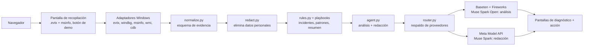
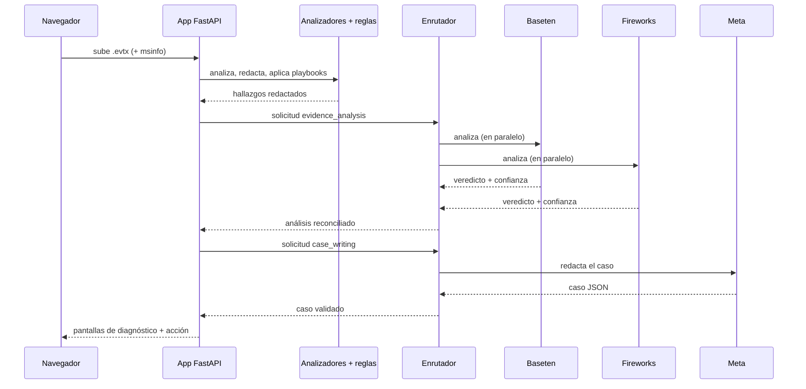

[](https://www.python.org/)
[](https://fastapi.tiangolo.com/)
[](LICENSE)
[](https://github.com/dochavez/faultcase/actions)
[](https://www.meta.ai/)

[Read in English](README.md)

**Idea en una línea:** FaultCase convierte los fallos repetidos de una laptop Windows en un caso de garantía listo para enviar al fabricante.


## Índice

- [Una noche frente a un minuto](#una-noche-frente-a-un-minuto)
- [El problema](#el-problema)
- [Pruébalo en 1 minuto](#pruébalo-en-1-minuto)
- [Capturas de pantalla](#capturas-de-pantalla)
- [Cómo funciona](#cómo-funciona)
- [Modelos y proveedores](#modelos-y-proveedores)
- [Cómo se construyó con Muse Code](#cómo-se-construyó-con-muse-code)
- [Privacidad y seguridad](#privacidad-y-seguridad)
- [Decisiones de diseño](#decisiones-de-diseño)
- [Limitaciones](#limitaciones)
- [Estructura del proyecto](#estructura-del-proyecto)
- [Ejecutar las pruebas](#ejecutar-las-pruebas)
- [Configuración](#configuración)
- [Hoja de ruta](#hoja-de-ruta)
- [Preguntas frecuentes para el jurado](#preguntas-frecuentes-para-el-jurado)
- [Licencia](#licencia)
- [Agradecimientos](#agradecimientos)

## Una noche frente a un minuto

Llegar a la conclusión del caso de demostración a mano tomó una noche entera. FaultCase hace el mismo trabajo desde una sola carga de archivos:

| Hecho a mano (una noche) | FaultCase (alrededor de un minuto) |
|---|---|
| Filtrar el Visor de eventos por eventos 41 / 6008 de Kernel-Power | `filters/device-diagnostics.xml` + `adapters/windows/evtx.py` |
| Ejecutar WinDbg `!analyze -v` en 4 volcados de memoria | `adapters/windows/windbg.py` (o `cdb.exe` local) |
| Comparar cubos de fallo y marcas de tiempo de controladores entre volcados | `rules.py`: `same_module`, `persists_across_driver_versions` |
| Contar incidentes, congelamientos y meses de historial | Bloque de resumen de `rules.py` (determinista, con pruebas) |
| Averiguar el modelo exacto de la laptop y la BIOS | Exportación de msinfo32 o lectura CIM local |
| Redactar el informe para el fabricante en dos idiomas | Redactor de casos con Muse Spark, EN + ES |

## El problema

Cuando una laptop nueva se reinicia sola una y otra vez, el problema cae entre tres empresas: Microsoft es dueña del sistema operativo, NVIDIA del controlador y Lenovo de la garantía. Cada una solo ve su propia parte. El usuario termina con fotos borrosas de un pantallazo azul y un equipo de soporte que le pide datos que no sabe dónde encontrar.

Este proyecto nació de un caso real: una Lenovo Legion Pro 7 16IAX10H (tipo de máquina 83F5, GPU NVIDIA, comprada en enero de 2026) con 6 incidentes en 6 meses (del 2026-04-22 al 2026-10-23). Cuatro fallos dejaron volcados de memoria, todos culpando a `nvlddmkm.sys` en dos compilaciones distintas del controlador (2026-03-04 y 2026-02-14); otros dos congelamientos no dejaron ningún volcado. Ese caso real anonimizado se incluye como la demostración de un clic.

## Pruébalo en 1 minuto

**Demostración en vivo:** [https://dochavez--faultcase-fastapi-app.us-east.modal.run/](https://dochavez--faultcase-fastapi-app.us-east.modal.run/)

Abre la URL de demostración y haz clic en **Try a sample case**: sin cuenta, sin código de invitación, instantáneo y gratis (el caso de demostración está precalculado; ver `scripts/build_demo_case.py`).

O ejecútalo localmente (Python 3.11, sin claves de API para la demo):

**Windows (PowerShell):**

```powershell
git clone https://github.com/dochavez/faultcase.git
cd faultcase
py -3.11 -m venv .venv
.venv\Scripts\Activate.ps1
pip install -r requirements.txt
copy .env.example .env   # fill in API keys only for new diagnoses, not for the demo
uvicorn faultcase.app:app --reload
```

**macOS / Linux:**

```bash
git clone https://github.com/dochavez/faultcase.git
cd faultcase
python3.11 -m venv .venv
source .venv/bin/activate
pip install -r requirements.txt
cp .env.example .env   # fill in API keys only for new diagnoses, not for the demo
uvicorn faultcase.app:app --reload
```

Después abre http://127.0.0.1:8000 y haz clic en **Try a sample case**.

<details>
<summary>Analiza tu propia laptop Windows</summary>

1. Abre la aplicación y haz clic en **Download device-diagnostics.xml** (paso 1 de la pantalla de recopilación).
2. En tu laptop: Visor de eventos → Acción → **Import Custom View…** → selecciona el archivo descargado.
3. Acción → **Save All Events in Custom View As…** → guarda el archivo `.evtx`.
4. De vuelta en la aplicación, sube el `.evtx` (máx. 20 MB) con tu código de invitación. Opcionalmente añade una exportación de msinfo32 (Windows + R → `msinfo32` → Archivo → Exportar), un informe de batería (`powercfg /batteryreport` en el Terminal), marca **Also analyze my memory dumps** si tienes `cdb.exe` y derechos de administrador, o deja que la aplicación lea los datos del equipo directamente en una ejecución local en Windows.
5. Lee el diagnóstico y abre la pantalla de acción para ver el informe para el fabricante (inglés/español), la lista de verificación previa al reclamo y el paquete de evidencias.

</details>

## Capturas de pantalla

Recopilación (guía de 4 pasos, cargas de archivos, botón del caso de ejemplo):


Diagnóstico (veredicto, línea de tiempo, hallazgos hecho/hipótesis, componentes sanos):


Acción (informe para el fabricante en inglés/español, lista de verificación, ZIP de evidencias, campo de número de serie solo en el navegador):


Versiones en inglés: [collect-en.png](docs/img/collect-en.png), [diagnosis-en.png](docs/img/diagnosis-en.png), [action-en.png](docs/img/action-en.png). Regenéralas cuando quieras con `python scripts/screenshots.py` (necesita `pip install playwright pillow` más `playwright install chromium`; solo datos de demostración, sin llamadas a modelos).

## Cómo funciona

Tres pantallas (FastAPI + Jinja2 + HTMX, inglés/español): **recopila** la evidencia, lee el **diagnóstico** y actúa en la pantalla de **acción**.



Una solicitud de principio a fin:



## Modelos y proveedores

| Rol | Modelo | Proveedor |
|---|---|---|
| Análisis técnico de la evidencia | Muse Spark Open | Baseten y Fireworks en paralelo (segunda opinión) |
| Redacción del caso y explicación al usuario | Muse Spark (`muse-spark-1.1`) | Meta Model API |
| Construcción de este proyecto | Muse Code | Terminal |

Las rutas viven en `config/providers.yaml`: `evidence_analysis: [baseten, fireworks]`, `case_writing: [meta, fireworks]`.

- **Segunda opinión.** Ambos proveedores de pesos abiertos analizan los mismos hallazgos redactados al mismo tiempo. Si el veredicto y la confianza coinciden, se conservan; si difieren, la confianza baja un nivel y se añade un hallazgo de tipo `hypothesis`. Si un proveedor falla, se continúa con la otra opinión. Se alterna con `analysis_mode: second_opinion | single`.
- **Caché de prompts.** Cada solicitud pone primero el contenido estático (prompt del sistema, reglas de playbooks, claves de salida) y los datos del caso al final, para que los proveedores reutilicen los prefijos en caché. Los tokens en caché se leen de `usage.prompt_tokens_details` y se registran en `logs/usage.jsonl`.
- **Solicitudes de cobertura (hedged).** Si el proveedor principal tarda más de `hedge_after_seconds` (25 por defecto), se inicia el siguiente proveedor y gana la primera respuesta válida; una línea `hedge` registra al ganador.
- **Esfuerzo de razonamiento por rol.** `medium` en ambos roles (omitido para el análisis en Baseten, cuya generación restringida se bloquea con él); los parámetros rechazados se reintentan una vez sin ellos y se recuerdan durante la sesión.
- **Límites de completado.** `max_tokens` por rol (16384 análisis, 24576 redacción, medidos desde los completados exitosos más grandes más un margen). `finish_reason == "length"` se registra como `truncated` y se reintenta una vez.

### Benchmark (medido el 2026-11-02)

`scripts/benchmark.py` ejecuta `build_case` 3 veces en el caso real más 6 casos sintéticos (`fixtures/synthetic/`: laptop sana, fallo de disco, fallo aislado, Wi-Fi, USB, batería). Resultados completos: [docs/benchmark.md](docs/benchmark.md).

| Provider | Role | Calls ok/total | Correct | p50 ms | p95 ms | Prompt | Compl | Cached | Est. cost | Fallbacks | Hedge wins |
| --- | --- | --- | --- | --- | --- | --- | --- | --- | --- | --- | --- |
| baseten | evidence_analysis | 21/21 | 100% (21/21) | 19975 | 26104 | 46611 | 59619 | 28928 | $0.5268 | 0 | 0 |
| fireworks | evidence_analysis | 21/21 | 100% (21/21) | 16465 | 31516 | 46590 | 36432 | 32128 | $0.3364 | 0 | 0 |
| meta | case_writing | 21/21 | 100% (21/21) | 12347 | 16926 | 50314 | 80466 | 26467 | $1.0570 | 0 | 0 |

Tasa de acuerdo de la segunda opinión: **71%** (15/21 ejecuciones con dos opiniones). Totales: 21 ejecuciones, 0 coberturas, $1.9202 estimados (precios de ejemplo en `config/providers.yaml`).

<details>
<summary>Cómo se juzga la corrección</summary>

El veredicto final del caso real debe estar en `acceptable_verdicts` de `fixtures/real_case/expected.json`. Cada otro veredicto acierta cuando contiene una palabra clave esperada (sin distinguir mayúsculas); las listas de palabras clave viven en `fixtures/synthetic/*.json`. Solo se guardan veredictos y métricas, nunca claves de API ni datos personales.

</details>

## Cómo se construyó con Muse Code

Cada característica siguiente es un commit revisado, construido con Muse Code (agente de terminal), según `git log`:

| Fecha | Commit |
|---|---|
| 30 oct | Set up environment and package skeleton |
| 30 oct | Add Windows adapter: evtx and WinDbg parsers |
| 1 nov | Add normalization and redaction |
| 1 nov | Add rules engine and golden real-case test |
| 1 nov | Add model router with fallback |
| 1 nov | Add case-building agent |
| 1 nov | Add three-screen web app |
| 1 nov | Serve precomputed demo case |
| 1 nov | Add msinfo32 export parser |
| 1 nov | Add cross-provider second opinion for evidence analysis |
| 1 nov | Add provider benchmark and results |
| 1 nov | Compare second opinions on enum verdicts |
| 1 nov | Make Baseten analysis reliable |

La **regla de la prueba dorada** mantuvo honesto al agente: `fixtures/real_case/expected.json` define las conclusiones que el sistema debe alcanzar y nunca debe editarse para que las pruebas pasen (`tests/test_real_case.py` verifica cada campo; la prueba en vivo verifica el veredicto, la confianza y las afirmaciones prohibidas).

<details>
<summary>Dos ejemplos reales de prompts (recortados, originales en inglés)</summary>

> Add automatic device identification so reports show the real model of the computer being analyzed. […] 1. Parser. Create `faultcase/adapters/windows/msinfo.py` that parses a System Information export (msinfo32 > File > Export […] often UTF-16 with BOM; detect the encoding). […] Never extract or keep the user name or computer name. […] 4. Serial number in the web version: on the Action screen add a "Serial number (optional)" field that replaces `{{SERIAL}}` […] using JavaScript in the browser only. The serial must never be sent to the server. […]

> Make better use of both open-weights providers and measure it. […] 1. Second opinion. For the evidence_analysis role, call Baseten and Fireworks in parallel […]. Compare verdicts: if they agree, keep the confidence; if they disagree, lower confidence by one level and add a finding of type "hypothesis" […]. 5. Benchmark. Create `scripts/benchmark.py` that runs build_case N times (default 3) on the real case plus 3 synthetic cases […] For each provider and role record: verdict correctness […], latency p50 and p95, […] estimated cost using the prices in providers.yaml […], fallback and hedge counts, and second-opinion agreement rate. […]

</details>

## Privacidad y seguridad

Cada garantía está respaldada por una prueba:

| Garantía | Respaldada por |
|---|---|
| Nombres de usuario y de equipo, MACs y correos eliminados del texto | `test_redact_text_removes_personal_data` |
| Ningún dato personal ni número de serie llega a los modelos | `test_personal_data_and_serial_never_reach_models` |
| El número de serie se sustituye localmente, solo si se proporciona | `test_serial_replaced_locally_only_when_provided` |
| El campo web de número de serie nunca envía nada al servidor | `test_serial_canary_never_reaches_server` |
| Las cargas de datos del equipo se redactan antes de usarse | `test_build_device_redacts_personal_data` |
| El ZIP de evidencias nunca contiene `.evtx`/`.dmp` crudos | `test_demo_flow_uses_precomputed_file` |
| Solo los campos analizados salen del análisis local de volcados | `test_analyze_dump_returns_only_parsed_fields` |
| El registro de uso nunca guarda prompts ni claves | `test_baseten_fails_fireworks_answers` |

Además: solo lectura (el producto nunca modifica el sistema del usuario), cargas procesadas en memoria o en una carpeta temporal y eliminadas justo después, y claves de API enmascaradas a sus últimos 4 caracteres dondequiera que se muestren.

## Decisiones de diseño

- **Primero las reglas deterministas.** Los conteos, fechas, códigos y patrones se calculan en Python con `rules.py` desde `playbooks/*.yaml`. Los modelos interpretan y redactan; nunca cuentan ni inventan datos.
- **Salida estructurada.** Cada respuesta de un modelo se valida contra un esquema JSON; si falla, el enrutador reintenta una vez y pasa al siguiente proveedor.
- **No es un chatbot.** Tres pantallas, un flujo: recopilación → diagnóstico → acción. Sin conversación abierta.
- **No analiza imágenes.** La evidencia son registros de eventos, resúmenes de volcados e información del sistema, nunca fotos.
- **Hecho frente a hipótesis.** Cada conclusión lleva su etiqueta; la correlación con transiciones de energía, por ejemplo, siempre es una hipótesis.
- **El usuario decide y envía.** El producto prepara evidencias y borradores; no da asesoría legal.

## Limitaciones

- Evidencia solo de Windows por hoy (`faultcase/adapters/` solo tiene `windows/`; la estructura está lista para Linux y macOS).
- Un `.evtx` sin volcados de memoria da un caso más débil (los congelamientos sin volcado se reportan como tales).
- Los hallazgos de Wi-Fi y USB necesitan una exportación hecha con el filtro actual (canales WLAN-AutoConfig y Kernel-PnP); las exportaciones antiguas simplemente muestran esos componentes como sanos.
- Los hallazgos de batería necesitan el HTML de `powercfg /batteryreport` (subido, o generado localmente en Windows); sin él, el informe lo dice.
- El mismo cubo o hash de fallo significa la misma *categoría* de fallo; no prueba el mismo defecto que en otras máquinas (una prueba en vivo afirma que el texto nunca dice eso).
- La salida en vivo de los modelos varía entre ejecuciones; la demo está precalculada para ser instantánea, gratis y estable.

## Estructura del proyecto

```
faultcase/                 # Paquete Python
  adapters/windows/        # evtx, windbg, fixture_events, msinfo, wmi, cdb (solo local)
  app.py                   # FastAPI, 3 pantallas + /demo
  agent.py                 # hallazgos → análisis (Baseten/Fireworks) → caso (Meta)
  normalize.py             # eventos crudos → schemas/evidence.schema.json
  redact.py                # eliminación de datos personales
  rules.py                 # playbooks → hallazgos deterministas
  router.py                # proveedores con respaldo, cobertura y registro de uso
  demo.py / i18n.py        # demo precalculada, cadenas EN/ES
templates/ static/         # páginas Jinja2, CSS
config/                    # providers.yaml (rutas, roles, precios)
filters/ playbooks/        # device-diagnostics.xml; disk/hardware/software/stability/thermal/wifi/usb/battery
prompts/ schemas/          # evidence_analysis.md, case_writer.md; esquemas evidence/case
fixtures/                  # real_case/, synthetic/, msinfo/
scripts/                   # smoke_test.py, build_demo_case.py, benchmark.py, screenshots.py
tests/                     # suite pytest (las pruebas en vivo necesitan claves)
docs/                      # benchmark.md/.json, img/
modal_app.py               # despliegue en Modal
```

## Ejecutar las pruebas

```bash
pytest            # suite completa: 155 pruebas, sin red ni claves de API
pytest -m live    # construye el caso real con modelos reales (necesita claves en .env)
```

## Configuración

`.env` (ver `.env.example`): `META_API_KEY`, `BASETEN_API_KEY`, `FIREWORKS_API_KEY`, `BASETEN_MODEL` (por defecto `meta-models/muse-spark-open-1026`), `INVITE_CODE` (obligatorio para cargas y regeneración en vivo de la demo; la demo en sí no lo necesita).

<details>
<summary>Referencia de <code>config/providers.yaml</code></summary>

- `providers.*`: `base_url`, `api_key_env`, `model`/`model_env`, precios de ejemplo `price_per_1k_*`.
- `routes`: `evidence_analysis: [baseten, fireworks]`, `case_writing: [meta, fireworks]`.
- `roles.*`: `analysis_mode` (`second_opinion` para análisis, `single` para redacción), `reasoning_effort` (`medium`, omitido para el análisis en Baseten), `max_tokens` (16384/24576).
- `settings`: `timeout_seconds: 90`, `max_retries_per_provider: 1`, `hedge_after_seconds: 25`, `log_usage: true`.

</details>

## Hoja de ruta

- Más playbooks (Bluetooth, impresoras).
- Adaptadores para Linux y macOS.
- Ejecuciones de benchmark más grandes con más casos sintéticos.

## Preguntas frecuentes para el jurado

**¿Necesito claves de API?**
No para la demo (`/demo` sirve un caso precalculado). Sí en `.env` para nuevos diagnósticos y `pytest -m live`.

**¿Qué datos salen de mi máquina?**
Solo hallazgos redactados: conteos, códigos, fechas, nombres de controladores. Los volcados de memoria nunca salen de la máquina, y el número de serie se inserta solo en el navegador.

**¿Por qué dos modelos para un análisis?**
Baseten y Fireworks analizan la misma evidencia de forma independiente; el acuerdo conserva la confianza, el desacuerdo la baja y lo dice. El benchmark mide a ambos (actualmente 71% de acuerdo, 15/21).

**¿Solo Windows?**
La recopilación de evidencia es Windows (`.evtx`, WinDbg, msinfo32, CIM, `powercfg`), pero el análisis de `.evtx` funciona en cualquier sistema: el servidor y CI también corren en Linux.

**¿Quién envía el informe al fabricante?**
Tú. FaultCase prepara el paquete de evidencias y el borrador bilingüe; no actúa en tu nombre.

## Licencia

Código: MIT (ver [LICENSE](LICENSE)). Muse Spark Open se usa bajo la Muse Model License, que exige mostrar "Built with Muse Spark Open" en el producto.

## Agradecimientos

A Meta por los modelos Muse y el acceso API del hackathon, a Baseten y Fireworks por servir Muse Spark Open, y a los mantenedores de `python-evtx` por el análisis multiplataforma de registros de eventos.

