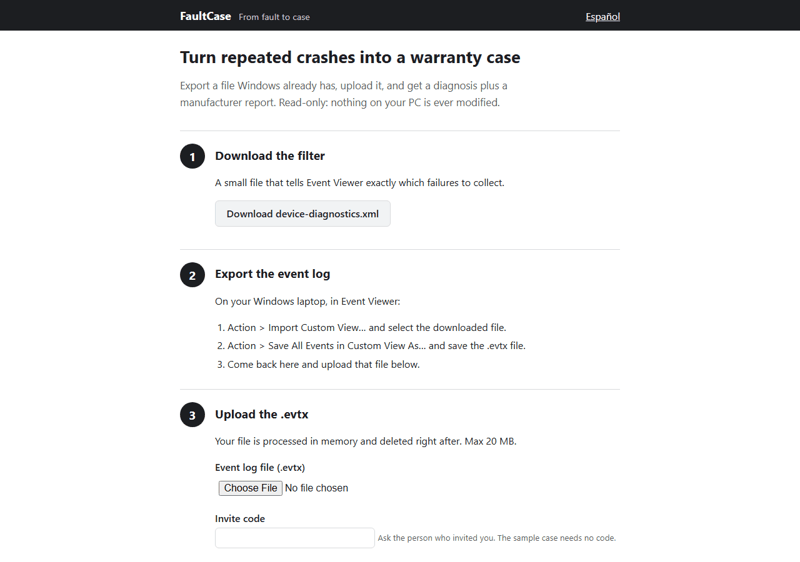
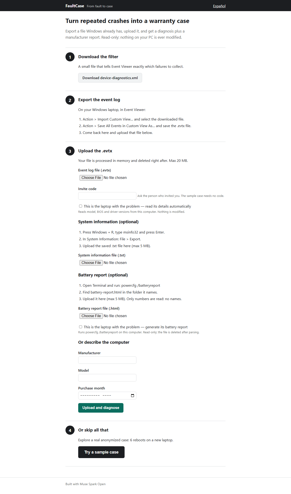
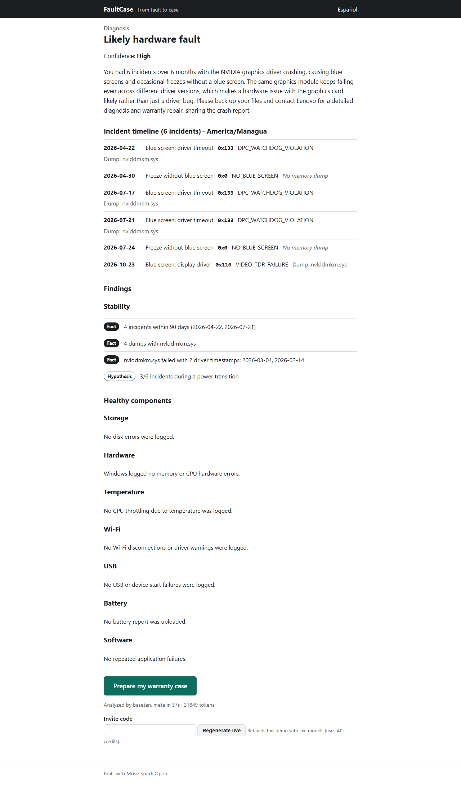
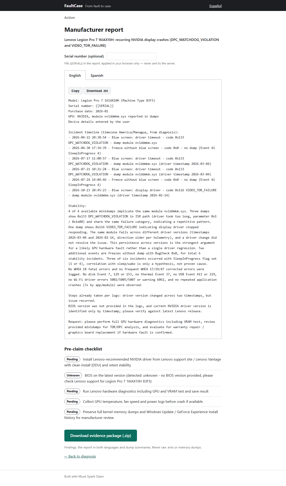
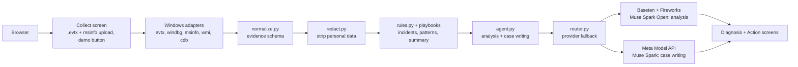
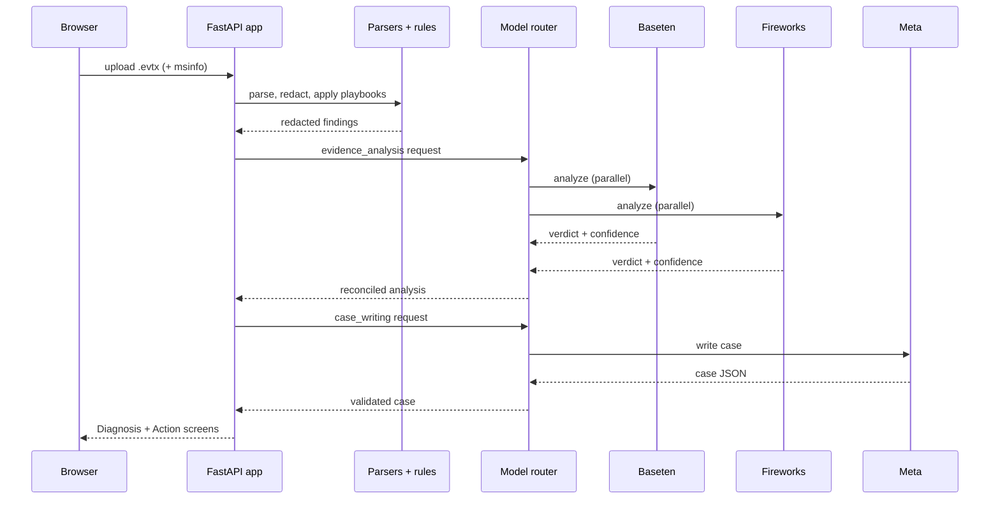
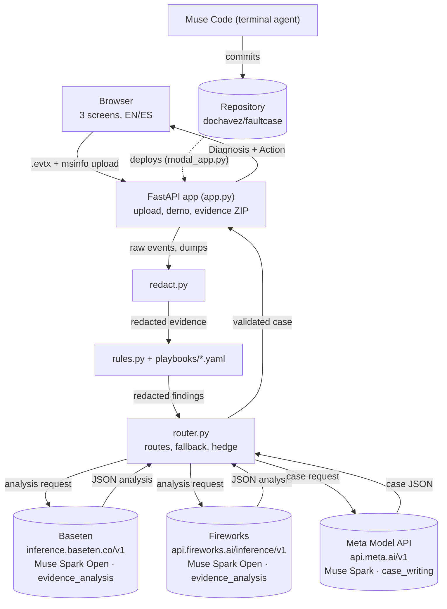
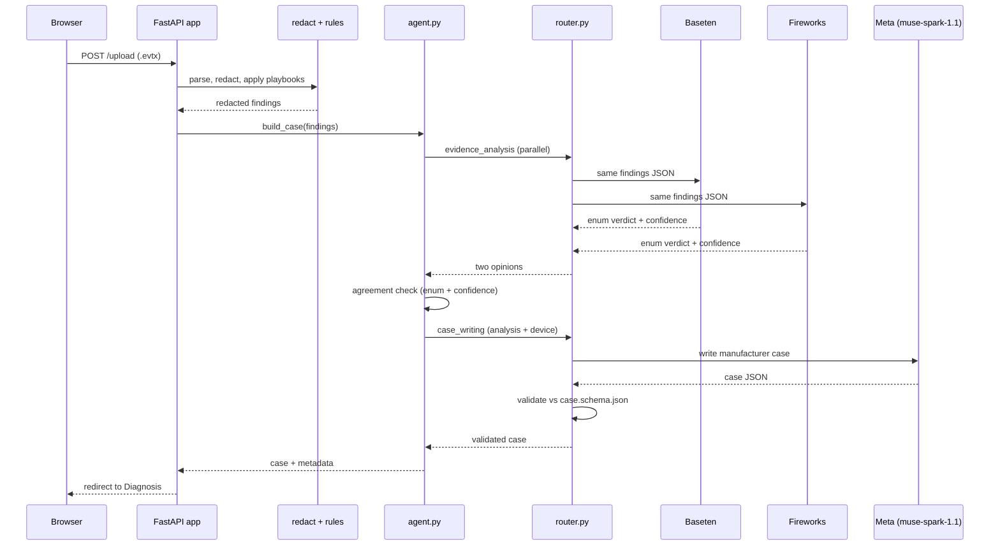
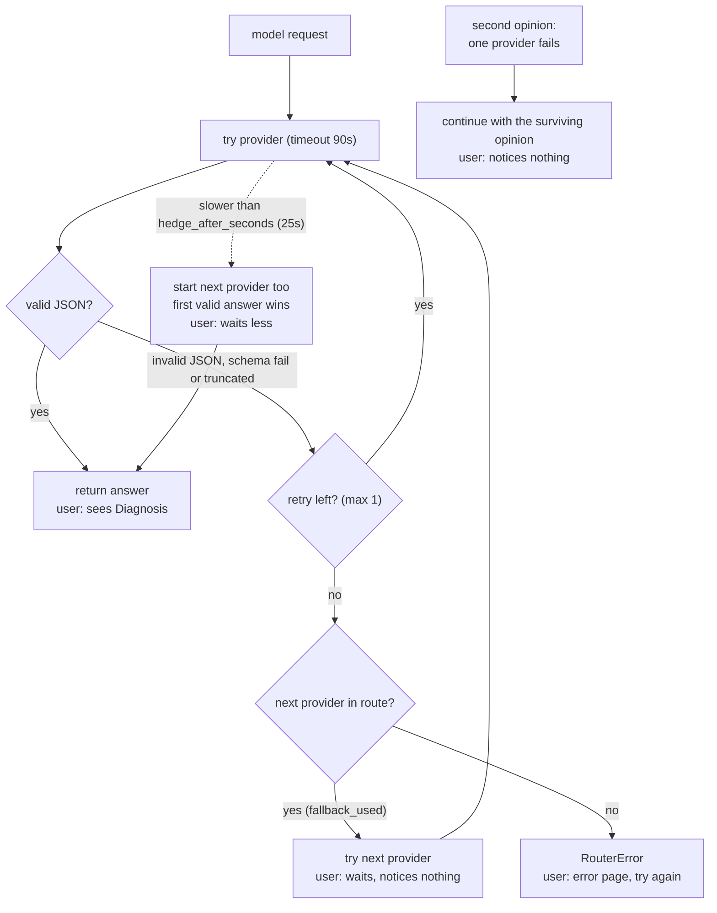

[](https://www.python.org/)
[](https://fastapi.tiangolo.com/)
[](LICENSE)
[](https://github.com/dochavez/faultcase/actions)
[](https://www.meta.ai/)

[Leer en español](README.es.md)

**Pitch:** FaultCase turns repeated crashes on a Windows laptop into a warranty case ready to send to the manufacturer.



## Table of contents

- [One night vs one minute](#one-night-vs-one-minute)
- [The problem](#the-problem)
- [Try it in 1 minute](#try-it-in-1-minute)
- [Screenshots](#screenshots)
- [How it works](#how-it-works)
- [Models and providers](#models-and-providers)
- [How Muse, Baseten and Fireworks work together](#how-muse-baseten-and-fireworks-work-together)
- [How it was built with Muse Code](#how-it-was-built-with-muse-code)
- [Privacy and safety](#privacy-and-safety)
- [Design decisions](#design-decisions)
- [Limitations](#limitations)
- [Project layout](#project-layout)
- [Run the tests](#run-the-tests)
- [Configuration](#configuration)
- [Roadmap](#roadmap)
- [FAQ for judges](#faq-for-judges)
- [License](#license)
- [Acknowledgments](#acknowledgments)

## One night vs one minute

Reaching the demo conclusion by hand took a full night. FaultCase does the same work from one upload:

| Done by hand (one night) | FaultCase (about one minute) |
|---|---|
| Filter Event Viewer for Kernel-Power 41 / 6008 events | `filters/device-diagnostics.xml` + `adapters/windows/evtx.py` |
| Run WinDbg `!analyze -v` on 4 memory dumps | `adapters/windows/windbg.py` (or local `cdb.exe`) |
| Compare failure buckets and driver timestamps across dumps | `rules.py`: `same_module`, `persists_across_driver_versions` |
| Count incidents, freezes, months of history | `rules.py` summary block (deterministic, tested) |
| Look up the exact laptop model and BIOS | msinfo32 export or local CIM reading |
| Write the manufacturer report in two languages | Muse Spark case writer, EN + ES |

## The problem

When a new laptop keeps rebooting on its own, the problem falls between three companies: Microsoft owns the OS, NVIDIA owns the driver, Lenovo owns the warranty. Each one sees only its own piece. The user ends up with blurry phone photos of a blue screen and a support team asking for data they don't know where to find.

This project was born from a real case: a Lenovo Legion Pro 7 16IAX10H (machine type 83F5, NVIDIA GPU, bought in January 2026) with 6 incidents in 6 months (2026-04-22 to 2026-10-23). Four crashes left memory dumps, all blaming `nvlddmkm.sys` across two driver builds (2026-03-04 and 2026-02-14); two more freezes left no dump at all. That real anonymized case ships as the one-click demo.

## Try it in 1 minute

**Live demo:** `[DEMO URL — added after Modal deploy]`

Open the demo URL and click **Try a sample case** — no account, no invite code, instant and free (the demo case is precomputed; see `scripts/build_demo_case.py`).

Or run it locally (Python 3.11, no API keys needed for the demo):

**Windows (PowerShell):**

```powershell
git clone https://github.com/dochavez/faultcase.git
cd faultcase
py -3.11 -m venv .venv
.venv\Scripts\Activate.ps1
pip install -r requirements.txt
copy .env.example .env   # fill in API keys only for new diagnoses, not for the demo
uvicorn faultcase.app:app --reload
```

**macOS / Linux:**

```bash
git clone https://github.com/dochavez/faultcase.git
cd faultcase
python3.11 -m venv .venv
source .venv/bin/activate
pip install -r requirements.txt
cp .env.example .env   # fill in API keys only for new diagnoses, not for the demo
uvicorn faultcase.app:app --reload
```

Then open http://127.0.0.1:8000 and click **Try a sample case**.

<details>
<summary>Analyze your own Windows laptop</summary>

1. Open the app and click **Download device-diagnostics.xml** (step 1 on the Collect screen).
2. On your laptop: Event Viewer → Action → **Import Custom View…** → select the downloaded file.
3. Action → **Save All Events in Custom View As…** → save the `.evtx` file.
4. Back in the app, upload the `.evtx` (max 20 MB) with your invite code. Optionally add an msinfo32 export (Windows + R → `msinfo32` → File → Export), a battery report (`powercfg /batteryreport` in Terminal), tick **Also analyze my memory dumps** if you have `cdb.exe` plus administrator rights, or let the app read the device details directly on a local Windows run.
5. Read the diagnosis, then open the Action screen for the manufacturer report (English/Spanish), the pre-claim checklist and the evidence package.

</details>

## Screenshots

Collect (step 1–4 guide, uploads, sample-case button):



Diagnosis (verdict, timeline, fact/hypothesis findings, healthy components):



Action (manufacturer report in English/Spanish, checklist, evidence ZIP, browser-only serial field):



Spanish versions: [collect-es.png](docs/img/collect-es.png), [diagnosis-es.png](docs/img/diagnosis-es.png), [action-es.png](docs/img/action-es.png). Regenerate them any time with `python scripts/screenshots.py` (needs `pip install playwright pillow` plus `playwright install chromium`; demo data only, no model calls).

## How it works

Three screens (FastAPI + Jinja2 + HTMX, English/Spanish): **Collect** the evidence, read the **Diagnosis**, act on the **Action** screen.



One request, end to end:



## Models and providers

| Role | Model | Provider |
|---|---|---|
| Technical evidence analysis | Muse Spark Open | Baseten and Fireworks in parallel (second opinion) |
| Writing the case, explaining it to the user | Muse Spark (`muse-spark-1.1`) | Meta Model API |
| Building this project | Muse Code | Terminal |

Routes live in `config/providers.yaml`: `evidence_analysis: [baseten, fireworks]`, `case_writing: [meta, fireworks]`.

- **Second opinion.** Both open-weights providers analyze the same redacted findings concurrently. Matching verdict enum + confidence is kept; a mismatch lowers confidence one level and adds a `hypothesis` finding. One failure continues with the other opinion. Toggle with `analysis_mode: second_opinion | single`.
- **Prompt caching.** Every request puts static content first (system prompt, playbook rules, output keys) and case data last, so providers can reuse cached prefixes. Cached tokens are read from `usage.prompt_tokens_details` and logged in `logs/usage.jsonl`.
- **Hedged requests.** If the primary provider is slower than `hedge_after_seconds` (default 25), the next provider starts and the first valid answer wins; a `hedge` line records the winner.
- **Reasoning effort per role.** `medium` for both roles (omitted for Baseten analysis, whose constrained generation stalls with it); rejected parameters are retried once without and remembered for the session.
- **Completion caps.** Per-role `max_tokens` (16384 analysis, 24576 writing, measured from the largest successful completions plus margin). `finish_reason == "length"` is logged as `truncated` and retried once.

### Benchmark (measured 2026-11-02)

`scripts/benchmark.py` runs `build_case` 3 times each on the real case plus 6 synthetic cases (`fixtures/synthetic/`: healthy laptop, disk failure, single isolated crash, Wi-Fi, USB, battery). Full results: [docs/benchmark.md](docs/benchmark.md).

| Provider | Role | Calls ok/total | Correct | p50 ms | p95 ms | Prompt | Compl | Cached | Est. cost | Fallbacks | Hedge wins |
| --- | --- | --- | --- | --- | --- | --- | --- | --- | --- | --- | --- |
| baseten | evidence_analysis | 21/21 | 100% (21/21) | 19975 | 26104 | 46611 | 59619 | 28928 | $0.5268 | 0 | 0 |
| fireworks | evidence_analysis | 21/21 | 100% (21/21) | 16465 | 31516 | 46590 | 36432 | 32128 | $0.3364 | 0 | 0 |
| meta | case_writing | 21/21 | 100% (21/21) | 12347 | 16926 | 50314 | 80466 | 26467 | $1.0570 | 0 | 0 |

Second-opinion agreement: **71%** (15/21 runs with two opinions). Totals: 21 runs, 0 hedges, $1.9202 estimated (example prices in `config/providers.yaml`).

<details>
<summary>How correctness is judged</summary>

The real-case final verdict must be in `acceptable_verdicts` in `fixtures/real_case/expected.json`. Every other verdict matches when it contains an expected keyword (case-insensitive); keyword lists live in `fixtures/synthetic/*.json`. Only verdicts and metrics are stored — never API keys or personal data.

</details>

## How Muse, Baseten and Fireworks work together

Integration map (every name, role and setting below comes from `config/providers.yaml` and `faultcase/router.py`):



One real request, step by step:



Resilience: what happens at each failure, and what the user sees:



## How it was built with Muse Code

Every feature below is one reviewed commit built with Muse Code (terminal agent), from `git log`:

| Date | Commit |
|---|---|
| Oct 30 | Set up environment and package skeleton |
| Oct 30 | Add Windows adapter: evtx and WinDbg parsers |
| Nov 1 | Add normalization and redaction |
| Nov 1 | Add rules engine and golden real-case test |
| Nov 1 | Add model router with fallback |
| Nov 1 | Add case-building agent |
| Nov 1 | Add three-screen web app |
| Nov 1 | Serve precomputed demo case |
| Nov 1 | Add msinfo32 export parser |
| Nov 1 | Add cross-provider second opinion for evidence analysis |
| Nov 1 | Add provider benchmark and results |
| Nov 1 | Compare second opinions on enum verdicts |
| Nov 1 | Make Baseten analysis reliable |

The **golden-test rule** kept the agent honest: `fixtures/real_case/expected.json` defines the conclusions the system must reach, and it must never be edited to make tests pass (`tests/test_real_case.py` checks every field; the live test checks the verdict, confidence and forbidden claims).

<details>
<summary>Two real example prompts (trimmed)</summary>

> Add automatic device identification so reports show the real model of the computer being analyzed. […] 1. Parser. Create `faultcase/adapters/windows/msinfo.py` that parses a System Information export (msinfo32 > File > Export […] often UTF-16 with BOM; detect the encoding). […] Never extract or keep the user name or computer name. […] 4. Serial number in the web version: on the Action screen add a "Serial number (optional)" field that replaces `{{SERIAL}}` […] using JavaScript in the browser only. The serial must never be sent to the server. […]

> Make better use of both open-weights providers and measure it. […] 1. Second opinion. For the evidence_analysis role, call Baseten and Fireworks in parallel […]. Compare verdicts: if they agree, keep the confidence; if they disagree, lower confidence by one level and add a finding of type "hypothesis" […]. 5. Benchmark. Create `scripts/benchmark.py` that runs build_case N times (default 3) on the real case plus 3 synthetic cases […] For each provider and role record: verdict correctness […], latency p50 and p95, […] estimated cost using the prices in providers.yaml […], fallback and hedge counts, and second-opinion agreement rate. […]

</details>

## Privacy and safety

Each guarantee is enforced by a test:

| Guarantee | Enforced by |
|---|---|
| User names, computer names, MACs, emails removed from text | `test_redact_text_removes_personal_data` |
| No personal data or serial reaches any model | `test_personal_data_and_serial_never_reach_models` |
| Serial replaced locally, only if provided | `test_serial_replaced_locally_only_when_provided` |
| Web serial field never sends anything to the server | `test_serial_canary_never_reaches_server` |
| Device uploads redacted before use | `test_build_device_redacts_personal_data` |
| Evidence ZIP never contains raw `.evtx`/`.dmp` | `test_demo_flow_uses_precomputed_file` |
| Only parsed fields leave local dump analysis | `test_analyze_dump_returns_only_parsed_fields` |
| Usage log never stores prompts or keys | `test_baseten_fails_fireworks_answers` |

Plus: read-only (the product never modifies the user's system), uploads processed in memory or a temp folder and deleted right after, and API keys masked to their last 4 characters anywhere they are shown.

## Design decisions

- **Deterministic rules first.** Counts, dates, codes and patterns are computed in Python by `rules.py` from `playbooks/*.yaml`. Models interpret and write; they never count or invent data.
- **Structured output.** Every model response is validated against a JSON schema; on failure the router retries once, then moves to the next provider.
- **Not a chatbot.** Three screens, one flow: Collect → Diagnosis → Action. No open conversation.
- **Not an image analyzer.** Evidence is event logs, dump summaries and system information — never photos.
- **Fact vs hypothesis.** Every conclusion carries its label; power-transition correlation, for example, is always a hypothesis.
- **The user decides and sends.** The product prepares evidence and drafts; it gives no legal advice.

## Limitations

- Windows evidence only today (`faultcase/adapters/` has just `windows/`; the layout is ready for Linux and macOS).
- An `.evtx` without memory dumps gives a weaker case (freezes without dumps are reported as such).
- Wi-Fi and USB findings need an export made with the current filter (WLAN-AutoConfig and Kernel-PnP channels); older exports simply show those components as healthy.
- Battery findings need the `powercfg /batteryreport` HTML (uploaded, or generated locally on Windows); without it the report says so.
- The same failure bucket or hash means the same failure *category*; it does not prove the same defect as other machines (a live test asserts the text never claims that).
- Live model output varies between runs; the demo is precomputed so it is instant, free and stable.

## Project layout

```
faultcase/                 # Python package
  adapters/windows/        # evtx, windbg, fixture_events, msinfo, wmi, cdb (local only)
  app.py                   # FastAPI, 3 screens + /demo
  agent.py                 # findings → analysis (Baseten/Fireworks) → case (Meta)
  normalize.py             # raw events → schemas/evidence.schema.json
  redact.py                # personal-data removal
  rules.py                 # playbooks → deterministic findings
  router.py                # providers with fallback, hedge, usage log
  demo.py / i18n.py        # precomputed demo, EN/ES strings
templates/ static/         # Jinja2 pages, CSS
config/                    # providers.yaml (routes, roles, prices)
filters/ playbooks/        # device-diagnostics.xml; disk/hardware/software/stability/thermal/wifi/usb/battery
prompts/ schemas/          # evidence_analysis.md, case_writer.md; evidence/case schemas
fixtures/                  # real_case/, synthetic/, msinfo/
scripts/                   # smoke_test.py, build_demo_case.py, benchmark.py, screenshots.py
tests/                     # pytest suite (live tests need keys)
docs/                      # benchmark.md/.json, img/
modal_app.py               # Modal deployment
```

## Run the tests

```bash
pytest            # full suite: 155 tests, no network and no API keys needed
pytest -m live    # builds the real case with real models (needs API keys in .env)
```

## Configuration

`.env` (see `.env.example`): `META_API_KEY`, `BASETEN_API_KEY`, `FIREWORKS_API_KEY`, `BASETEN_MODEL` (defaults to `meta-models/muse-spark-open-1026`), `INVITE_CODE` (required for uploads and live demo regeneration; the demo itself needs none).

<details>
<summary><code>config/providers.yaml</code> reference</summary>

- `providers.*`: `base_url`, `api_key_env`, `model`/`model_env`, example `price_per_1k_*` prices.
- `routes`: `evidence_analysis: [baseten, fireworks]`, `case_writing: [meta, fireworks]`.
- `roles.*`: `analysis_mode` (`second_opinion` for analysis, `single` for writing), `reasoning_effort` (`medium`, omitted for Baseten analysis), `max_tokens` (16384/24576).
- `settings`: `timeout_seconds: 90`, `max_retries_per_provider: 1`, `hedge_after_seconds: 25`, `log_usage: true`.

</details>

## Roadmap

- More playbooks (Bluetooth, printers).
- Linux and macOS adapters.
- Larger benchmark runs across more synthetic cases.

## FAQ for judges

**Do I need API keys?**
No for the demo (`/demo` serves a precomputed case). Yes in `.env` for new diagnoses and `pytest -m live`.

**What data leaves my machine?**
Only redacted findings: counts, codes, dates, driver names. Memory dumps never leave the machine, and the serial number is inserted in the browser only.

**Why two models for one analysis?**
Baseten and Fireworks independently analyze the same evidence; agreement keeps confidence, disagreement lowers it and says so. The benchmark measures both (currently 71% agreement, 15/21).

**Windows only?**
Evidence collection is Windows (`.evtx`, WinDbg, msinfo32, CIM, `powercfg`), but `.evtx` parsing runs anywhere — the server and CI run on Linux too.

**Who sends the report to the manufacturer?**
You do. FaultCase prepares the evidence package and the bilingual draft; it takes no action on your behalf.

## License

Code: MIT (see [LICENSE](LICENSE)). Muse Spark Open is used under the Muse Model License, which requires displaying "Built with Muse Spark Open" in the product.

## Acknowledgments

Meta for the Muse models and hackathon API access, Baseten and Fireworks for serving Muse Spark Open, and the `python-evtx` maintainers for cross-platform event-log parsing.

