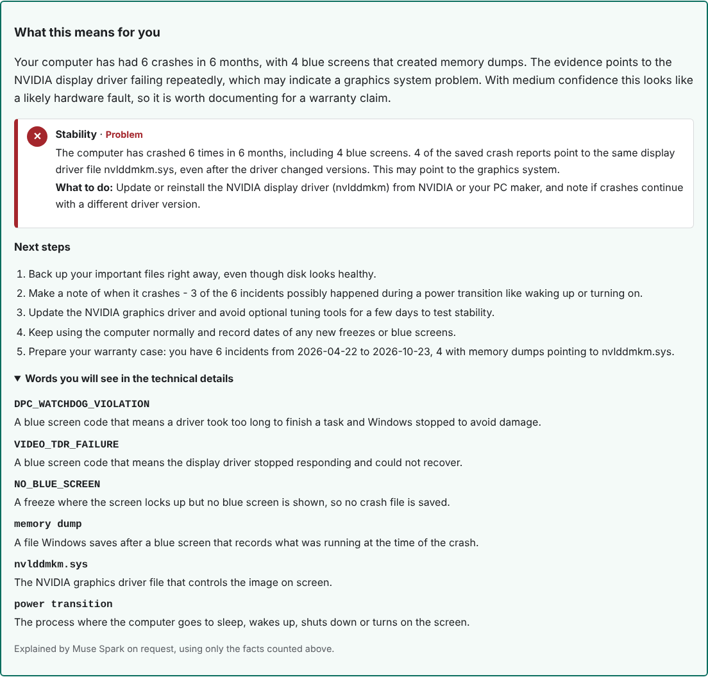
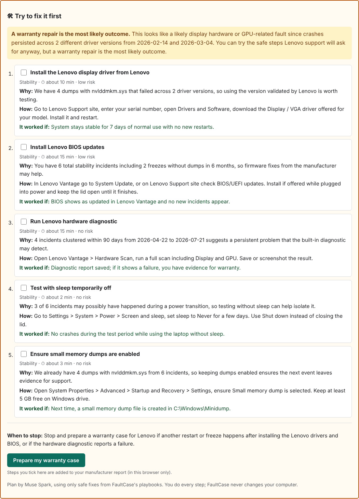
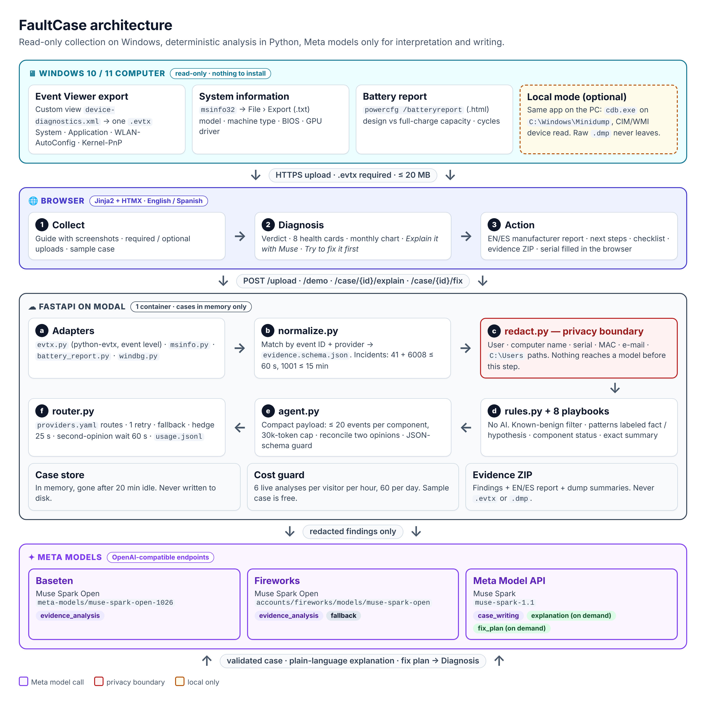
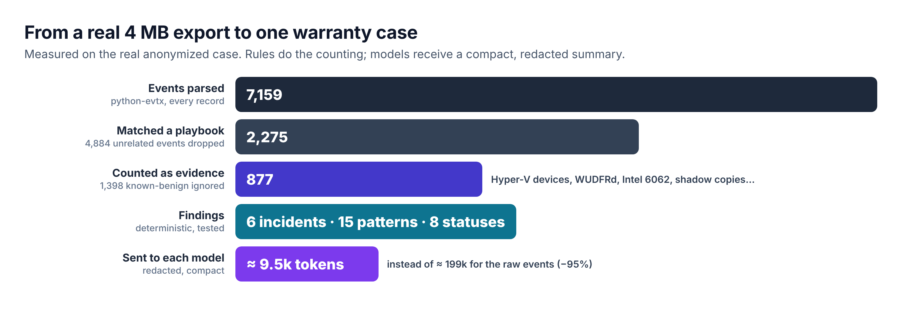
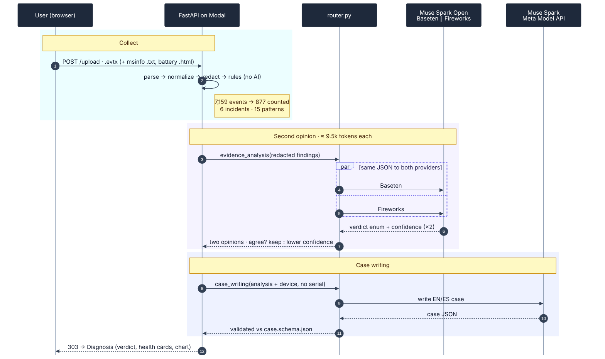
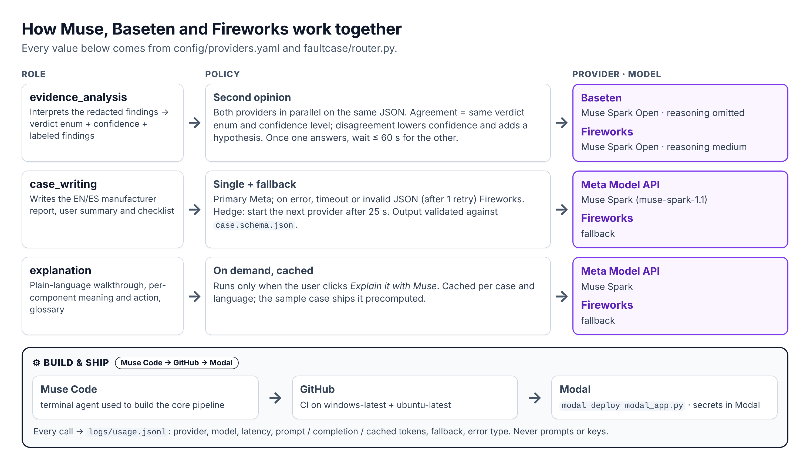
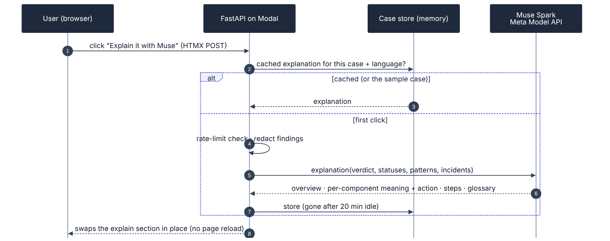
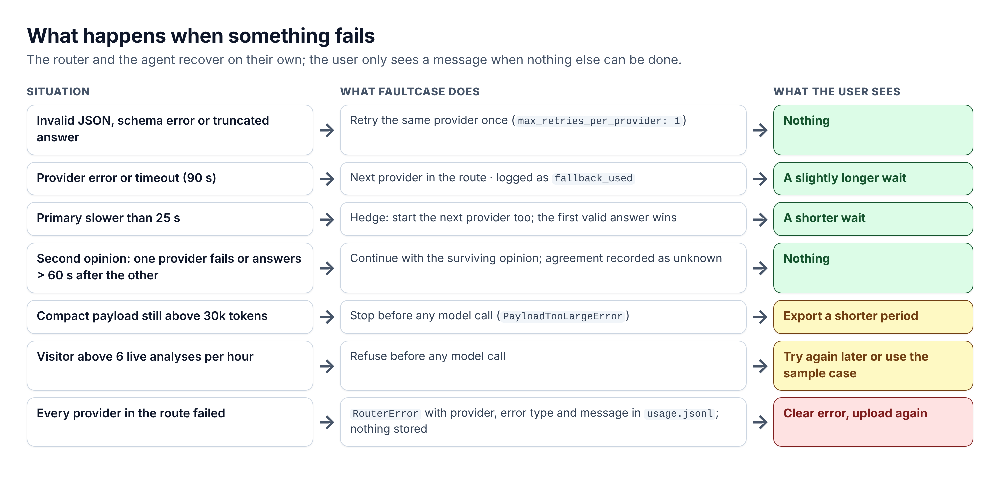

[](https://www.python.org/)
[](https://fastapi.tiangolo.com/)
[](LICENSE)
[](https://github.com/dochavez/faultcase/actions)
[](https://www.meta.ai/)

[Leer en español](README.es.md)

**Pitch:** FaultCase turns repeated crashes on a Windows 10 or 11 computer (laptop or desktop) into a warranty case ready to send to the manufacturer.


## Table of contents

- [One night vs one minute](#one-night-vs-one-minute)
- [The problem](#the-problem)
- [Try it in 1 minute](#try-it-in-1-minute)
- [Screenshots](#screenshots)
- [How it works](#how-it-works)
- [Models and providers](#models-and-providers)
- [How Muse, Baseten and Fireworks work together](#how-muse-baseten-and-fireworks-work-together)
- [How it was built with Muse Code](#how-it-was-built-with-muse-code)
- [Privacy and safety](#privacy-and-safety)
- [Design decisions](#design-decisions)
- [Limitations](#limitations)
- [Project layout](#project-layout)
- [Run the tests](#run-the-tests)
- [Configuration](#configuration)
- [Roadmap](#roadmap)
- [FAQ](#faq)
- [License](#license)
- [Acknowledgments](#acknowledgments)

## One night vs one minute

Reaching the demo conclusion by hand took a full night. FaultCase does the same work from one upload:

| Done by hand (one night) | FaultCase (about one minute) |
|---|---|
| Filter Event Viewer for Kernel-Power 41 / 6008 events | `filters/device-diagnostics.xml` + `adapters/windows/evtx.py` |
| Run WinDbg `!analyze -v` on 4 memory dumps | `adapters/windows/windbg.py` (or local `cdb.exe`) |
| Compare failure buckets and driver timestamps across dumps | `rules.py`: `same_module`, `persists_across_driver_versions` |
| Count incidents, freezes, months of history | `rules.py` summary block (deterministic, tested) |
| Look up the exact laptop model and BIOS | msinfo32 export or local CIM reading |
| Write the manufacturer report in two languages | Muse Spark case writer, EN + ES |

## The problem

When a new laptop keeps rebooting on its own, the problem falls between three companies: Microsoft owns the OS, NVIDIA owns the driver, Lenovo owns the warranty. Each one sees only its own piece. The user ends up with blurry phone photos of a blue screen and a support team asking for data they don't know where to find.

This project was born from a real case: a Lenovo Legion Pro 7 16IAX10H (machine type 83F5, NVIDIA GPU, bought in January 2026) with 6 incidents in 6 months (2026-04-22 to 2026-10-23). Four crashes left memory dumps, all blaming `nvlddmkm.sys` across two driver builds (2026-03-04 and 2026-02-14); two more freezes left no dump at all. That real anonymized case ships as the one-click demo.

## Try it in 1 minute

**Live demo:** [https://dochavez--faultcase-fastapi-app.us-east.modal.run/](https://dochavez--faultcase-fastapi-app.us-east.modal.run/)  
**Backup demo (Render):** [https://faultcase.onrender.com](https://faultcase.onrender.com)

Open the demo URL and click **Try a sample case** — no account, no invite code, instant and free (the demo case is precomputed; see `scripts/build_demo_case.py`).

Or run it locally (Python 3.11, no API keys needed for the demo):

**Windows (PowerShell):**

```powershell
git clone https://github.com/dochavez/faultcase.git
cd faultcase
py -3.11 -m venv .venv
.venv\Scripts\Activate.ps1
pip install -r requirements.txt
copy .env.example .env   # fill in API keys only for new diagnoses, not for the demo
uvicorn faultcase.app:app --reload
```

**macOS / Linux:**

```bash
git clone https://github.com/dochavez/faultcase.git
cd faultcase
python3.11 -m venv .venv
source .venv/bin/activate
pip install -r requirements.txt
cp .env.example .env   # fill in API keys only for new diagnoses, not for the demo
uvicorn faultcase.app:app --reload
```

Then open http://127.0.0.1:8000 and click **Try a sample case**.

<details>
<summary>Analyze your own Windows laptop</summary>

1. Open the app and click **Download device-diagnostics.xml** (step 1 on the Collect screen).
2. On your laptop: Event Viewer → Action → **Import Custom View…** → select the downloaded file.
3. Action → **Save All Events in Custom View As…** → save the `.evtx` file.
4. Back in the app, upload the `.evtx` (max 20 MB) with your invite code. Optionally add an msinfo32 export (Windows + R → `msinfo32` → File → Export), a battery report (`powercfg /batteryreport` in Terminal), tick **Also analyze my memory dumps** if you have `cdb.exe` plus administrator rights, or let the app read the device details directly on a local Windows run.
5. Read the diagnosis, then open the Action screen for the manufacturer report (English/Spanish), the pre-claim checklist and the evidence package.

</details>

## Screenshots

**Collect** — Windows 10/11 badge, step-by-step Event Viewer guide with screenshots, required/optional uploads, sample case:


**Diagnosis** — verdict card with the main problem and two paths (*Try to fix it first* or *Prepare my warranty case*), 8 component health cards, restarts-per-month chart, incident timeline, *Explain it with Muse*, technical details for the manufacturer's technician:


**Explain it with Muse** — on demand, Muse Spark turns the counted facts into plain words: what each finding means, what to do, next steps and a glossary:



**Try to fix it first** — on demand, Muse Spark turns the playbooks' safe fixes for the components that need attention into an ordered plan (why, how, minutes, risk, how to check, when to stop). Ticked steps are added to the manufacturer report in the browser:



**Action** — what to do next (with the manufacturer's support link), EN/ES manufacturer report, checklist, evidence ZIP, serial number filled in the browser only:


Spanish versions: [collect-es.png](docs/img/collect-es.png), [diagnosis-es.png](docs/img/diagnosis-es.png), [explain-es.png](docs/img/explain-es.png), [fix-es.png](docs/img/fix-es.png), [action-es.png](docs/img/action-es.png). Regenerate them with `python scripts/screenshots.py` (dev tools: `pip install playwright pillow` and `playwright install chromium`; sample case only, no model calls).

## How it works

Three screens (FastAPI + Jinja2 + HTMX, English/Spanish): **Collect** the evidence, read the **Diagnosis**, act on the **Action** screen. Python does all counting; the Meta models only interpret and write.



What the deterministic core does before any model is called:

- **Parse** every record with `python-evtx`, including the Windows event level (critical, error, warning, information).
- **Normalize** against 8 playbooks (`playbooks/*.yaml`): stability, storage, hardware, temperature, Wi-Fi, USB, battery, software. Only stability events form incidents: event 41 and 6008 within 60 s, and a 1001 bug-check report within 15 min of its 41.
- **Ignore known-benign noise** with explicit rules: virtual Hyper-V/software devices (`ROOT\`, `SWD\`), the WUDFRd framework driver, Intel Wi-Fi 6062, user- or system-initiated Wi-Fi disconnects, informational NTFS 98, corruption reported on Volume Shadow Copy snapshots, successful updates.
- **Compute** patterns labeled `fact` or `hypothesis`, a status per component (problem, needs attention, no problems, no data) and an exact summary (incident count, dates, months, dumps, driver direction).
- **Compact** the payload: per component, counts plus at most 20 representative redacted events, with a 30k-token hard cap.

On the real anonymized export this turns 7,159 events into a ~9.5k-token request:



One upload, end to end:



## Models and providers

| Role | Model | Provider |
|---|---|---|
| Technical evidence analysis | Muse Spark Open | Baseten and Fireworks in parallel (second opinion) |
| Writing the EN/ES manufacturer case and user summary | Muse Spark (`muse-spark-1.1`) | Meta Model API (Fireworks as fallback) |
| *Explain it with Muse*: plain-language walkthrough on demand | Muse Spark (`muse-spark-1.1`) | Meta Model API (Fireworks as fallback) |
| *Try to fix it first*: self-help plan from the playbooks' safe fixes, on demand | Muse Spark (`muse-spark-1.1`) | Meta Model API (Fireworks as fallback) |
| Building this project | Muse Code | Terminal |

Routes live in `config/providers.yaml`: `evidence_analysis: [baseten, fireworks]`, `case_writing: [meta, fireworks]`, `explanation: [meta, fireworks]`, `fix_plan: [meta, fireworks]`.

- **Second opinion.** Both open-weights providers analyze the same redacted findings concurrently. Matching verdict enum + confidence is kept; a mismatch lowers confidence one level and adds a `hypothesis` finding. One failure, or an answer more than 60 s after the first one (`second_opinion_wait_seconds`), continues with the surviving opinion. Toggle with `analysis_mode: second_opinion | single`.
- **Prompt caching.** Every request puts static content first (system prompt, playbook rules, output keys) and case data last, so providers can reuse cached prefixes. Cached tokens are read from `usage.prompt_tokens_details` and logged in `logs/usage.jsonl`.
- **Hedged requests.** If the primary provider is slower than `hedge_after_seconds` (default 25), the next provider starts and the first valid answer wins; a `hedge` line records the winner.
- **Reasoning effort per role.** `medium` for both roles (omitted for Baseten analysis, whose constrained generation stalls with it); rejected parameters are retried once without and remembered for the session.
- **Completion caps.** Per-role `max_tokens` (16384 analysis, 24576 writing, 8192 explanation and fix plan; analysis and writing measured from the largest successful completions plus margin). `finish_reason == "length"` is logged as `truncated` and retried once.

### Benchmark (measured 2026-11-02)

`scripts/benchmark.py` runs `build_case` 3 times each on the real case plus 6 synthetic cases (`fixtures/synthetic/`: healthy laptop, disk failure, single isolated crash, Wi-Fi, USB, battery). Full results: [docs/benchmark.md](docs/benchmark.md).

| Provider | Role | Calls ok/total | Correct | p50 ms | p95 ms | Prompt | Compl | Cached | Est. cost | Fallbacks | Hedge wins |
| --- | --- | --- | --- | --- | --- | --- | --- | --- | --- | --- | --- |
| baseten | evidence_analysis | 21/21 | 100% (21/21) | 19975 | 26104 | 46611 | 59619 | 28928 | $0.5268 | 0 | 0 |
| fireworks | evidence_analysis | 21/21 | 100% (21/21) | 16465 | 31516 | 46590 | 36432 | 32128 | $0.3364 | 0 | 0 |
| meta | case_writing | 21/21 | 100% (21/21) | 12347 | 16926 | 50314 | 80466 | 26467 | $1.0570 | 0 | 0 |

Second-opinion agreement: **71%** (15/21 runs with two opinions). Totals: 21 runs, 0 hedges, $1.9202 estimated (example prices in `config/providers.yaml`).

<details>
<summary>How correctness is judged</summary>

The real-case final verdict must be in `acceptable_verdicts` in `fixtures/real_case/expected.json`. Every other verdict matches when it contains an expected keyword (case-insensitive); keyword lists live in `fixtures/synthetic/*.json`. Only verdicts and metrics are stored — never API keys or personal data.

</details>

## How Muse, Baseten and Fireworks work together



*Explain it with Muse*, on demand and cached:



Resilience: what happens at each failure, and what the user sees:



Diagram sources: `docs/diagrams/` (rebuild with `python docs/diagrams/build_diagrams.py` and `mmdc`).

## How it was built with Muse Code

Every feature below is one reviewed commit built with Muse Code (terminal agent), from `git log`:

| Commit | Feature |
|---|---|
| [`bf8c73d`](https://github.com/dochavez/faultcase/commit/bf8c73d) | Set up environment and package skeleton |
| [`a58ac1e`](https://github.com/dochavez/faultcase/commit/a58ac1e) | Add provider smoke test |
| [`c8b765c`](https://github.com/dochavez/faultcase/commit/c8b765c) | Add Windows adapter: evtx and WinDbg parsers |
| [`723de43`](https://github.com/dochavez/faultcase/commit/723de43) | Add normalization and redaction |
| [`b673bbb`](https://github.com/dochavez/faultcase/commit/b673bbb) | Add rules engine and golden real-case test |
| [`3ca3e26`](https://github.com/dochavez/faultcase/commit/3ca3e26) | Add model router with fallback |
| [`e462f40`](https://github.com/dochavez/faultcase/commit/e462f40) | Add case-building agent |
| [`3d3bbc2`](https://github.com/dochavez/faultcase/commit/3d3bbc2) | Add three-screen web app |
| [`cf17104`](https://github.com/dochavez/faultcase/commit/cf17104) | Add Modal deployment |
| [`99b012c`](https://github.com/dochavez/faultcase/commit/99b012c) | Add local minidump analysis |
| [`13ba425`](https://github.com/dochavez/faultcase/commit/13ba425) | Serve precomputed demo case |
| [`5392efa`](https://github.com/dochavez/faultcase/commit/5392efa) | Add msinfo32 export parser |
| [`c3a3812`](https://github.com/dochavez/faultcase/commit/c3a3812) | Read device details locally with CIM queries |
| [`ef0cb2e`](https://github.com/dochavez/faultcase/commit/ef0cb2e) | Add browser-only serial number field |
| [`bc55cd8`](https://github.com/dochavez/faultcase/commit/bc55cd8) | Add cross-provider second opinion for evidence analysis |
| [`1789446`](https://github.com/dochavez/faultcase/commit/1789446) | Order prompts for caching and log cached tokens |
| [`15733e0`](https://github.com/dochavez/faultcase/commit/15733e0) | Add hedged requests |
| [`dd19a0a`](https://github.com/dochavez/faultcase/commit/dd19a0a) | Configure reasoning effort per role |
| [`aaf89fd`](https://github.com/dochavez/faultcase/commit/aaf89fd) | Add provider benchmark and results |
| [`bc56b7e`](https://github.com/dochavez/faultcase/commit/bc56b7e) | Compare second opinions on enum verdicts |
| [`289912f`](https://github.com/dochavez/faultcase/commit/289912f) | Cap completion length and detect truncation |
| [`7c2a89c`](https://github.com/dochavez/faultcase/commit/7c2a89c) | Make Baseten analysis reliable |
| [`eaf9b3f`](https://github.com/dochavez/faultcase/commit/eaf9b3f) | Add Wi-Fi playbook with verified event IDs |
| [`870c344`](https://github.com/dochavez/faultcase/commit/870c344) | Add USB playbook with verified event IDs |
| [`4381749`](https://github.com/dochavez/faultcase/commit/4381749) | Add battery playbook, parser and upload |
| [`36acb22`](https://github.com/dochavez/faultcase/commit/36acb22) | Add component fixtures, benchmark cases and golden tests |
| [`8152610`](https://github.com/dochavez/faultcase/commit/8152610) | Group diagnosis by component, report sections per component |
| [`de72d48`](https://github.com/dochavez/faultcase/commit/de72d48) | On-demand explanation backend: `explain_case`, `prompts/explainer.md`, `explanation` route |

The **golden-test rule** kept the agent honest: `fixtures/real_case/expected.json` defines the conclusions the system must reach, and it must never be edited to make tests pass (`tests/test_real_case.py` checks every field; the live test checks the verdict, confidence and forbidden claims).

<details>
<summary>Two real example prompts (trimmed)</summary>

> Add automatic device identification so reports show the real model of the computer being analyzed. […] 1. Parser. Create `faultcase/adapters/windows/msinfo.py` that parses a System Information export (msinfo32 > File > Export […] often UTF-16 with BOM; detect the encoding). […] Never extract or keep the user name or computer name. […] 4. Serial number in the web version: on the Action screen add a "Serial number (optional)" field that replaces `{{SERIAL}}` […] using JavaScript in the browser only. The serial must never be sent to the server. […]

> Make better use of both open-weights providers and measure it. […] 1. Second opinion. For the evidence_analysis role, call Baseten and Fireworks in parallel […]. Compare verdicts: if they agree, keep the confidence; if they disagree, lower confidence by one level and add a finding of type "hypothesis" […]. 5. Benchmark. Create `scripts/benchmark.py` that runs build_case N times (default 3) on the real case plus 3 synthetic cases […] For each provider and role record: verdict correctness […], latency p50 and p95, […] estimated cost using the prices in providers.yaml […], fallback and hedge counts, and second-opinion agreement rate. […]

</details>

## Privacy and safety

Each guarantee is enforced by a test:

| Guarantee | Enforced by |
|---|---|
| User names, computer names, MACs, emails removed from text | `test_redact_text_removes_personal_data` |
| No personal data or serial reaches any model | `test_personal_data_and_serial_never_reach_models` |
| Serial replaced locally, only if provided | `test_serial_replaced_locally_only_when_provided` |
| Web serial field never sends anything to the server | `test_serial_canary_never_reaches_server` |
| Device uploads redacted before use | `test_build_device_redacts_personal_data` |
| Evidence ZIP never contains raw `.evtx`/`.dmp` | `test_demo_flow_uses_precomputed_file` |
| Models get counts plus ≤ 20 events per component, never the raw log (30k-token cap) | `test_twenty_thousand_events_fit_the_token_budget` |
| *Explain it with Muse* receives only redacted findings | `test_explain_case_sends_only_redacted_findings` |
| *Try to fix it first* only adapts safe fixes of the components that need attention | `test_fix_plan_uses_only_safe_fixes_of_involved_components` |
| Known-benign events are never counted as faults | `test_known_benign_events_are_not_counted` |
| Failure bucket IDs are stripped from manufacturer reports | `test_strip_bucket_ids_from_reports` |
| Only parsed fields leave local dump analysis | `test_analyze_dump_returns_only_parsed_fields` |
| Usage log never stores prompts or keys | `test_baseten_fails_fireworks_answers` |

Plus: read-only (the product never modifies the user's system), uploads processed in memory or a temp folder and deleted right after, cases kept in memory only (gone after 20 minutes idle), the Modal image ships only the filter file (never a personal `.evtx`), and API keys masked to their last 4 characters anywhere they are shown.

## Design decisions

- **Deterministic rules first.** Counts, dates, codes and patterns are computed in Python by `rules.py` from `playbooks/*.yaml`. Models interpret and write; they never count or invent data.
- **Structured output.** Every model response is validated against a JSON schema; on failure the router retries once, then moves to the next provider.
- **Not a chatbot.** Three screens, one flow: Collect → Diagnosis → Action. No open conversation.
- **Not an image analyzer.** Evidence is event logs, dump summaries and system information — never photos.
- **Fact vs hypothesis.** Every conclusion carries its label; power-transition correlation, for example, is always a hypothesis.
- **The user decides and sends.** The product prepares evidence and drafts; it gives no legal advice.

## Limitations

- Windows 10 and 11 only (laptops and desktops). `faultcase/adapters/` has just `windows/`; Linux and macOS need their own adapters and playbooks, not just instructions. The app tells macOS/Linux visitors so.
- An `.evtx` without memory dumps gives a weaker case (freezes without dumps are reported as such).
- Wi-Fi and USB findings need an export made with the current filter (WLAN-AutoConfig and Kernel-PnP channels); older exports simply show those components as healthy.
- Battery findings need the `powercfg /batteryreport` HTML (uploaded, or generated locally on Windows); without it the report says so.
- The same failure bucket or hash means the same failure *category*; it does not prove the same defect as other machines (a live test asserts the text never claims that).
- Cases live in memory: a restart or 20 idle minutes clears them (by design, for privacy).
- Live model output varies between runs; the demo is precomputed so it is instant, free and stable.

## Project layout

```
faultcase/                 # Python package
  adapters/windows/        # evtx, windbg, fixture_events, msinfo, wmi, cdb (local only)
  app.py                   # FastAPI, 3 screens + /demo
  agent.py                 # findings → analysis (Baseten/Fireworks) → case (Meta)
  normalize.py             # raw events → schemas/evidence.schema.json
  redact.py                # personal-data removal
  rules.py                 # playbooks → deterministic findings
  router.py                # providers with fallback, hedge, usage log
  demo.py / i18n.py        # precomputed demo, EN/ES strings
templates/ static/         # Jinja2 pages, CSS, Event Viewer guide screenshots
config/                    # providers.yaml (routes, roles, prices)
filters/ playbooks/        # device-diagnostics.xml; disk/hardware/software/stability/thermal/wifi/usb/battery
prompts/ schemas/          # evidence_analysis.md, case_writer.md, explainer.md, fix_planner.md; evidence/case schemas
fixtures/                  # real_case/, synthetic/, msinfo/
scripts/                   # smoke_test.py, build_demo_case.py, benchmark.py, screenshots.py
tests/                     # pytest suite (live tests need keys)
docs/                      # benchmark.md/.json, img/, diagrams/ (sources)
modal_app.py               # Modal deployment (primary)
render.yaml                # Render Blueprint (backup deployment)
```

## Run the tests

```bash
pytest            # full suite, no network and no API keys needed
pytest -m live    # builds the real case with real models (needs API keys in .env)
```

## Configuration

`.env` (see `.env.example`): `META_API_KEY`, `BASETEN_API_KEY`, `FIREWORKS_API_KEY`, `BASETEN_MODEL` (defaults to `meta-models/muse-spark-open-1026`), `INVITE_CODE` (optional: when set, uploads and live demo regeneration ask for it; when empty the field is hidden and live analyses are limited by `UPLOADS_PER_HOUR`, default 6 per visitor, and `UPLOADS_PER_DAY`, default 60).

<details>
<summary><code>config/providers.yaml</code> reference</summary>

- `providers.*`: `base_url`, `api_key_env`, `model`/`model_env`, example `price_per_1k_*` prices.
- `routes`: `evidence_analysis: [baseten, fireworks]`, `case_writing: [meta, fireworks]`, `explanation: [meta, fireworks]`, `fix_plan: [meta, fireworks]`.
- `roles.*`: `analysis_mode` (`second_opinion` for analysis, `single` for writing), `reasoning_effort` (`medium`, omitted for Baseten analysis), `max_tokens` (16384/24576/8192), `second_opinion_wait_seconds: 60`.
- `settings`: `timeout_seconds: 90`, `max_retries_per_provider: 1`, `hedge_after_seconds: 25`, `log_usage: true`.

</details>

## Roadmap

- More playbooks (Bluetooth, printers).
- Linux and macOS adapters.
- Larger benchmark runs across more synthetic cases.

## FAQ

**Do I need API keys?**
No for the demo (`/demo` serves a precomputed case). Yes in `.env` for new diagnoses and `pytest -m live`.

**What data leaves my machine?**
Only redacted findings: counts, codes, dates, driver names. Memory dumps never leave the machine, and the serial number is inserted in the browser only.

**Why two models for one analysis?**
Baseten and Fireworks independently analyze the same evidence; agreement keeps confidence, disagreement lowers it and says so. The benchmark measures both (currently 71% agreement, 15/21).

**Windows only?**
Yes: Windows 10 and 11 computers, laptops and desktops (the battery report applies to laptops only). The evidence is Windows-specific (`.evtx`, WinDbg, msinfo32, CIM, `powercfg`), but parsing runs anywhere — the server on Modal and CI run on Linux. Linux and macOS are on the roadmap as separate adapters.

**Can Muse help me fix it without opening a ticket?**
Yes: *Try to fix it first* gives an ordered plan built only from FaultCase's safe fixes for your findings (manufacturer driver, BIOS, hardware diagnostic, sleep test, Wi-Fi power setting…), with how long each step takes and how to know it worked. You do every step; FaultCase never changes your computer. When the evidence points to hardware it says so, and the steps you ticked go into the warranty report.

**What does "Explain it with Muse" do?**
On request, Muse Spark reads the counted facts (never the raw log) and explains them in plain words: what each finding means, what to do, the next steps and a glossary for the technical details. It runs once per case and language and is cached; the sample case ships it precomputed.

**Who sends the report to the manufacturer?**
You do. FaultCase prepares the evidence package and the bilingual draft; it takes no action on your behalf.

## License

Code: MIT (see [LICENSE](LICENSE)). Muse Spark Open is used under the Muse Model License, which requires displaying "Built with Muse Spark Open" in the product.

## Acknowledgments

Meta for the Muse models and hackathon API access, Baseten and Fireworks for serving Muse Spark Open, and the `python-evtx` maintainers for cross-platform event-log parsing.

